# Lab 08: AWS Account Setup, IAM, VPC, EC2, Docker, and Gitea

**Estimated duration:** 3 hours  
**Submission repository:** `CC`  
**Submission directory:** `Labs/Lab08`  
**Screenshot directory:** `Labs/Lab08/screenshots`

Use your Windows host, a web browser, and an AWS lab account. Run the server commands on the EC2 instance created in this lab. Submit all evidence to your existing GitHub repository named exactly `CC`.

## Lab Objective

Create and access an AWS account, practice IAM users, inspect VPC resources in Middle East (UAE), launch an EC2 instance, deploy Gitea with Docker Compose, and remove the resources created for the exercise.

By the end of this lab, you will be able to:

- complete account signup and enable the UAE region;
- create temporary IAM users and verify console sign-in;
- inspect VPCs, subnets, route tables, and network ACLs;
- launch an Amazon Linux EC2 instance and connect with an SSH key;
- install Docker and Compose and deploy Gitea; and
- verify cleanup and review incurred cloud costs.

## Prerequisites

- A Windows host with a current browser and OpenSSH client.
- An AWS account or the payment/contact information required for the account-registration exercise.
- Permission to enable `me-central-1` and create the specified IAM/EC2 resources.
- A secure local location for IAM credential CSV files and `Lab8Key.pem` outside the Git repository.
- Access to your existing GitHub repository named `CC`.

This lab retains the source account-creation exercise using the **AWS Paid Plan**. Review current pricing and credit eligibility before launching resources; do not assume that EC2, storage, or public IPv4 usage is free. Complete the cleanup section after collecting evidence.

Use **Amazon Linux 2023 (x86_64)** and **t3.micro** consistently. Amazon Linux 2 reached end of support on 30 June 2026; AL2023 uses DNF. The copied reference images show the earlier console/AMI and are illustrations; follow the written configuration and capture your own current evidence.

## Required Folder Structure

Your completed Lab 08 directory must follow this structure:

```text
CC/
└── Labs/
    └── Lab08/
        ├── README.md
        ├── Lab8_Solution.pdf
        ├── images/                 # instructor reference images
        ├── workspace/
        │   └── compose.yaml
        └── screenshots/
            ├── task1_open_signup_page.png
            └── ...
```

Keep every original evidence screenshot inside `Labs/Lab08/screenshots/`. Store the final compose.yaml in `workspace/`; keep passwords, private keys, and credential exports outside this directory.

## Task List

- [Screenshot Rules](#screenshot-rules)
- [Required Screenshot Filenames](#required-screenshot-filenames)
- [Getting Started](#getting-started)
- [Task 1: Create an AWS Account and Enable the UAE Region](#task-1-create-an-aws-account-and-enable-the-uae-region)
- [Task 2: Create IAM Admin and Lab8User Accounts](#task-2-create-iam-admin-and-lab8user-accounts)
- [Task 3: Inspect VPC Resources in the UAE Region](#task-3-inspect-vpc-resources-in-the-uae-region)
- [Task 4: Launch EC2 and Deploy Gitea with Docker Compose](#task-4-launch-ec2-and-deploy-gitea-with-docker-compose)
- [Cleanup: Remove Lab Resources](#cleanup-remove-lab-resources)
- [Troubleshooting and Notes](#troubleshooting-and-notes)
- [Summary](#summary)
- [Submission](#submission)
- [Final Submission Checklist](#final-submission-checklist)

---

## Screenshot Rules

1. Save every required screenshot inside `Labs/Lab08/screenshots/`.
2. Use the exact filename and capitalization specified for its step.
3. Every terminal screenshot must show the active prompt, required command, and relevant output.
4. AWS screenshots must show the requested account/user or resource and its relevant result. VPC and EC2 evidence must show `me-central-1`; IAM is global. EC2 terminal screenshots must show the actual `ec2-user@...` prompt, SSH command where requested, and output. The standard local-VM prompt `<github-username>@ubuntu` does not apply to Amazon Linux.
5. GitHub username comparison is case-insensitive, but its spelling must match the Student Marks Portal registration.
6. GUI screenshots must clearly show the requested application, setting, account, or result. Instructor reference images are not submission evidence.
7. Where a step groups commands into one screenshot, capture all of those commands and outputs together. Where evidence is explicitly optional or conditional, follow that condition.
8. Screenshots must be readable, unedited evidence from your own work. Do not crop away required identity, commands, filenames, or results. Tile windows before taking a screenshot when a combined view is requested.
9. Do not expose real passwords, password hashes, private keys, access tokens, recovery codes, or payment details. Supplied training-only example values may appear where the task requires them.
10. Do not copy, reuse, or modify another student's screenshots.
11. Commit and push the complete `Labs/Lab08` directory before the deadline.

Missing, unclear, incorrectly named, misplaced, edited, or copied evidence may receive zero marks for the affected check.

### Required Screenshot Filenames

These are the 38 required Lab 8 guided-task screenshot filenames, including cleanup evidence. Save them inside `Labs/Lab08/screenshots/` using the exact names below:

```text
task1_open_signup_page.png
task1_signed_up_confirmation.png
task1_root_signed_in.png
task1_enable_region_me-central-1.png
task1_summary.png
task2_open_iam_console.png
task2_admin_create_confirmation.png
task2_admin_csv_and_signin_url.png
task2_admin_console_after_login.png
task2_create_lab8user_and_csv.png
task2_lab8user_csv_saved.png
task2_lab8user_logged_in.png
task2_summary.png
task3_open_vpc_console.png
task3_vpcs_list.png
task3_subnets_list.png
task3_route_tables_list.png
task3_network_acls_list.png
task3_summary.png
task4_open_ec2_console.png
task4_launch_instance_config.png
task4_keypair_download.png
task4_instance_running_console.png
task4_ssh_from_windows_to_ec2.png
task4_ec2_install_docker_compose_started.png
task4_vim_compose_yaml_paste.png
task4_compose_yaml_saved_ls.png
task4_usermod_and_groups_before_after.png
task4_docker_compose_up.png
task4_security_group_allow_3000.png
task4_gitea_install_page.png
task4_gitea_create_repo.png
task4_summary.png
cleanup_terminate_instance.png
cleanup_delete_volumes_snapshots.png
cleanup_delete_security_group_and_keypair.png
cleanup_iam_users_deleted.png
cleanup_summary.png
```

## Getting Started

1. From the root of your local `CC` repository, create the submission directories:

   ```powershell
   New-Item -ItemType Directory -Force -Path .\Labs\Lab08\screenshots, .\Labs\Lab08\workspace | Out-Null
   ```

2. Use the Windows host for AWS console and SSH-client work. Keep all payment details, console passwords, private SSH keys, and credential CSV contents out of screenshots and out of Git.
3. Read all guided tasks and the submission requirements before beginning.

---

## Task 1: Create an AWS Account and Enable the UAE Region

Goal: Register a new AWS root account and enable the UAE me-central-1 region.

### Steps

Do these steps in order and capture a screenshot immediately after each numbered step. Place screenshots in Labs/Lab08/screenshots/.

1. Open your browser and go to: [AWS Signup](https://signin.aws.amazon.com/signup?request_type=register)  

   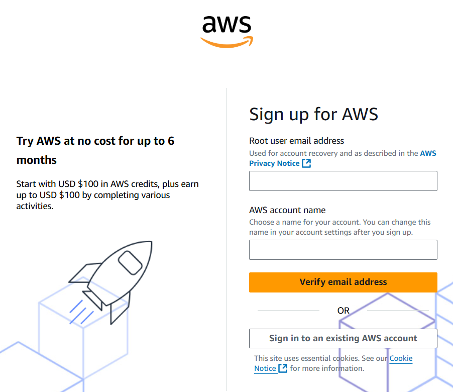

   - Save screenshot as: `task1_open_signup_page.png` — browser showing the signup page.

2. Complete registration (Account type: Personal, Plan: AWS Paid Plan), fill contact, billing (credit card) and phone details, complete verification. After successful registration capture:  
   - Save screenshot as: `task1_signed_up_confirmation.png` — registration success/confirmation page or payment confirmation (do not display payment-card details).

3. Sign in as the root user (root email). Immediately capture:  
   - Save screenshot as: `task1_root_signed_in.png` — AWS Console Home after root login (top bar with root email/account alias visible).

4. Open **Account → AWS Regions**, enable **Middle East (UAE) — me-central-1**, and wait for its status to become enabled. Then select that region for VPC and EC2. Region activation can take time; a region-selector entry alone does not enable an opt-in region. Capture the enabled/selected region:

   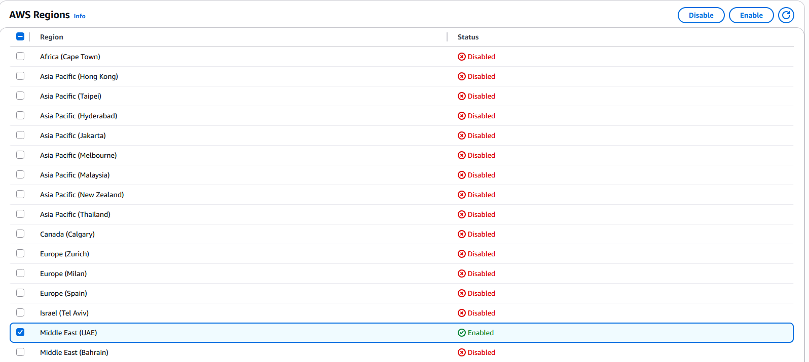

   - Save screenshot as: `task1_enable_region_me-central-1.png` — region selector showing me-central-1 selected.

5. Task 1 summary screenshot (combine evidence):  

   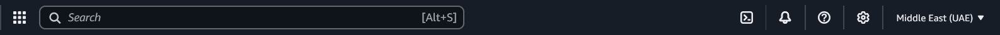

   - Save screenshot as: `task1_summary.png` — single screenshot showing root console header (root email/account alias) and region set to me-central-1.

Important: Record your root login email, but never share your root password. Clean up resources after the lab.

**Screenshot Required:**

- `task1_open_signup_page.png`
- `task1_signed_up_confirmation.png`
- `task1_root_signed_in.png`
- `task1_enable_region_me-central-1.png`
- `task1_summary.png`

---

## Task 2: Create IAM Admin and Lab8User Accounts

Goal: Create an IAM user named Admin (console access + AdministratorAccess policy), download the .csv, logout root, then login as the IAM Admin and create Lab8User with same permissions.

### Steps

Do these steps in order and capture a screenshot immediately after each numbered step/substep. Place screenshots in Labs/Lab08/screenshots/.

1. Open IAM via Console search (Alt+S → "IAM").  

   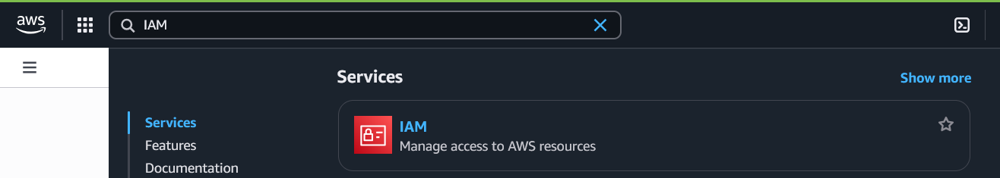

   - Save screenshot as: `task2_open_iam_console.png` — IAM console landing page. IAM is a global service, so its region selector can display Global.

2. Create the Admin user: IAM → Users → Create user. Fill:

   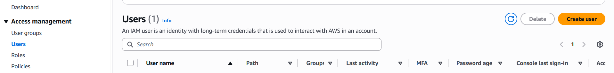

   - Username: Admin
   - Provide user access to the AWS Management Console
   - Set console password (autogenerate or set)

   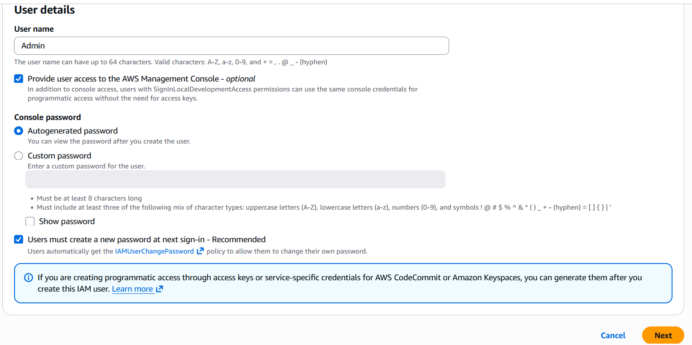

   - Attach policies directly → AdministratorAccess  

   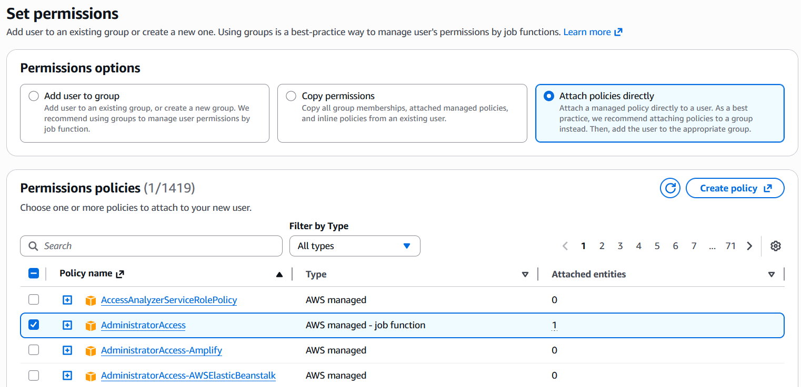

   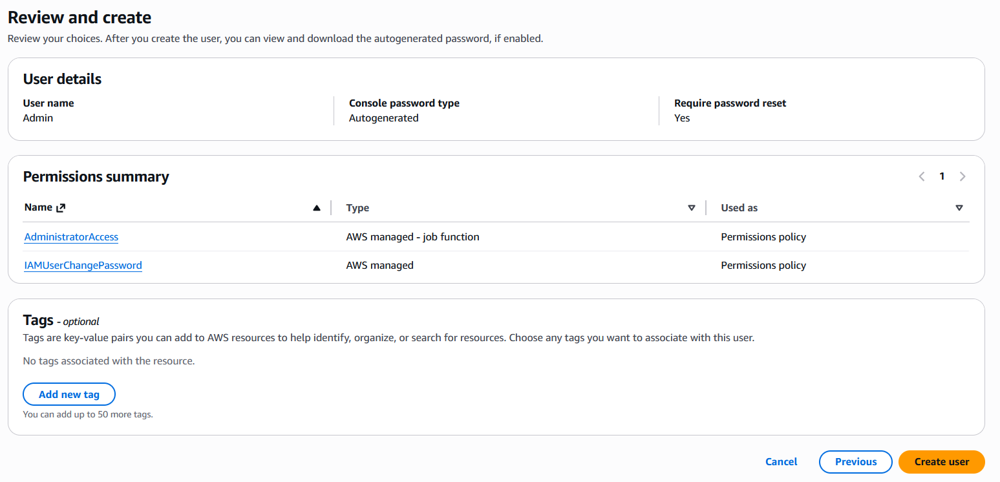

   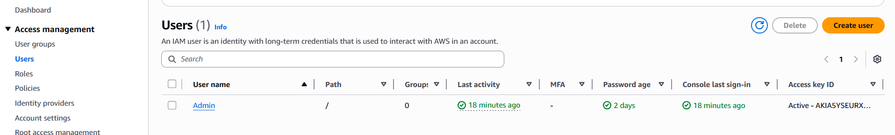

   Capture the completion screen when user is created:  
   - Save screenshot as: `task2_admin_create_confirmation.png` — IAM "Create user" success screen showing Admin (do NOT include password).

3. Download the Admin .csv and show its presence on your Windows host (do not display the password text):  
   - Save screenshot as: `task2_admin_csv_and_signin_url.png` — Windows File Explorer showing the downloaded CSV filename, with the IAM sign-in URL available in the browser. Keep the CSV contents closed so no password appears.

4. Sign out of root, then sign in using the Admin account (use the signin URL from the .csv). Capture after successful Admin login:  
   - Save screenshot as: `task2_admin_console_after_login.png` — Admin user console home.

5. While logged in as Admin, create Lab8User:
   - IAM → Users → Create user
   - Username: Lab8User
   - Provide user access to the AWS Management Console
   - Attach AdministratorAccess policy  
   Capture the create-user success screen:  
   - Save screenshot as: `task2_create_lab8user_and_csv.png` — Lab8User create confirmation and CSV download prompt (do NOT include password).

6. Download/save the Lab8User CSV on your Windows host (do not show password).  
   - Save screenshot as: `task2_lab8user_csv_saved.png` — File Explorer showing the Lab8User CSV filename with its contents closed.

7. Logout Admin and login as Lab8User (use the Lab8User signin URL and credentials). Capture after login:  
   - Save screenshot as: `task2_lab8user_logged_in.png` — Lab8User console home.

8. Task 2 summary (combine evidence):  
   - Save screenshot as: `task2_summary.png` — IAM Users list showing both Admin and Lab8User present. The UAE region requirement applies to the regional VPC and EC2 tasks.

Notes:

- Keep the .csv files private. Only include signin URL and console screens in submission—do not include password text in screenshots.

**Screenshot Required:**

- `task2_open_iam_console.png`
- `task2_admin_create_confirmation.png`
- `task2_admin_csv_and_signin_url.png`
- `task2_admin_console_after_login.png`
- `task2_create_lab8user_and_csv.png`
- `task2_lab8user_csv_saved.png`
- `task2_lab8user_logged_in.png`
- `task2_summary.png`

---

## Task 3: Inspect VPC Resources in the UAE Region

Goal: In the VPC console list the counts of specific resources.

### Steps

Do these steps in order and capture a screenshot immediately after viewing each page. Place screenshots in Labs/Lab08/screenshots/.

1. Open VPC console (Alt+S → "VPC") while region is me-central-1.  

   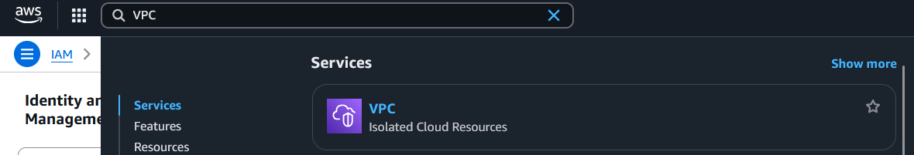

   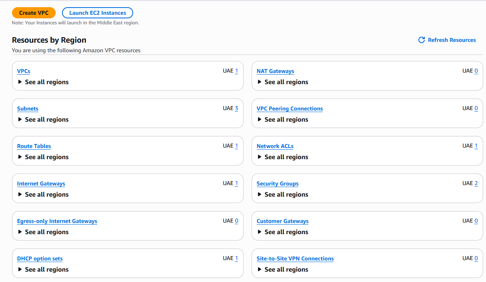

   - Save screenshot as: `task3_open_vpc_console.png` — VPC console landing page (region visible).

2. View VPCs list. Capture:  
   - Save screenshot as: `task3_vpcs_list.png` — VPCs list view (show default VPC if present).

3. View Subnets list. Capture:  
   - Save screenshot as: `task3_subnets_list.png` — Subnets list view (show at least 3 default subnets if present).

4. View Route Tables list. Capture:  
   - Save screenshot as: `task3_route_tables_list.png` — Route Tables list view.

5. View Network ACLs list. Capture:  
   - Save screenshot as: `task3_network_acls_list.png` — Network ACLs list view.

6. Task 3 summary (combine evidence):  
   - Save screenshot as: `task3_summary.png` — a single screenshot showing the VPC console left navigation and counts or multiple open tabs/windows tiled to show each resource's list (region me-central-1 visible).

In each screenshot show the console top bar with region set to me-central-1.

**Screenshot Required:**

- `task3_open_vpc_console.png`
- `task3_vpcs_list.png`
- `task3_subnets_list.png`
- `task3_route_tables_list.png`
- `task3_network_acls_list.png`
- `task3_summary.png`

---

## Task 4: Launch EC2 and Deploy Gitea with Docker Compose

Goal: Launch an EC2 instance named Lab8Machine, configure security group Lab8SecurityGroup allowing SSH from your IP, create an ED25519 key pair Lab8Key (.pem), SSH from Windows host, install Docker & Docker Compose, create compose.yaml from the repository, run docker compose up -d, allow inbound TCP port 3000, and open Gitea UI.

### Steps

1. Open EC2 Console (Alt+S → "EC2") (me-central-1).  

   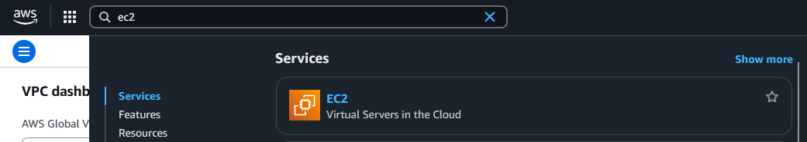

   - Save screenshot as: `task4_open_ec2_console.png` — EC2 console landing page with region visible.

   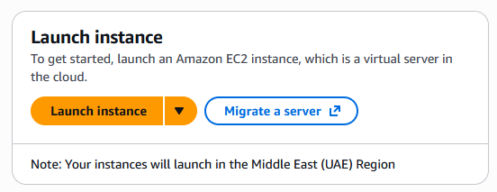

2. Instance Launch configuration (during review before launching). Configure:
   - Name: Lab8Machine

   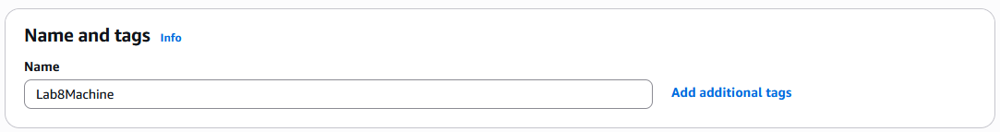

   - AMI: Amazon Linux 2023 (x86_64)

   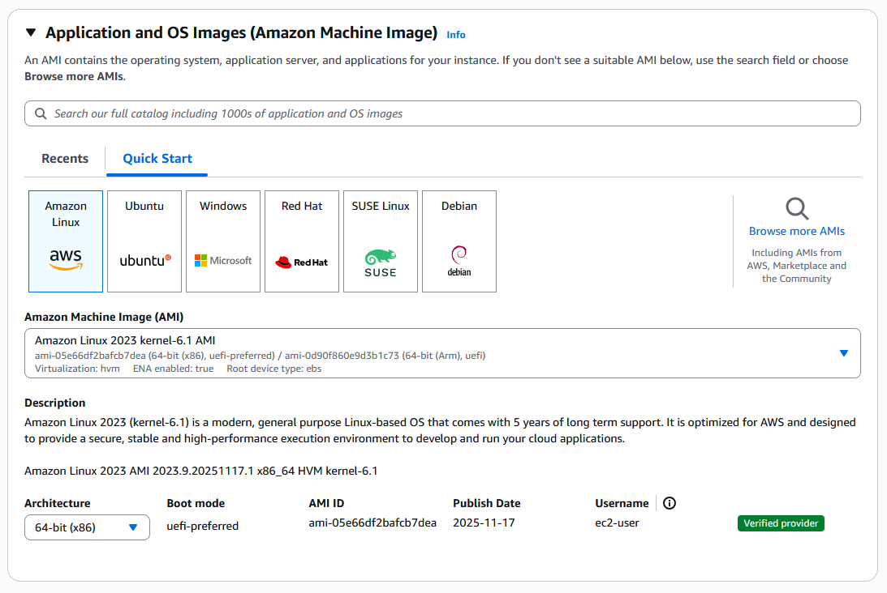

   - Instance type: t3.micro

   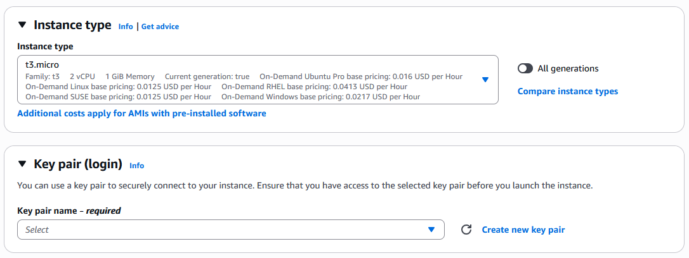

   - Security group: Create Lab8SecurityGroup with SSH from My IP

   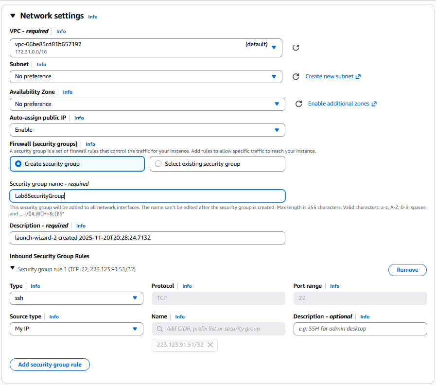

   - Storage: default

   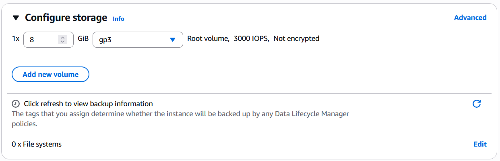

   - Key pair: Create Lab8Key (ED25519, .pem) and download the .pem file to your Windows host  

   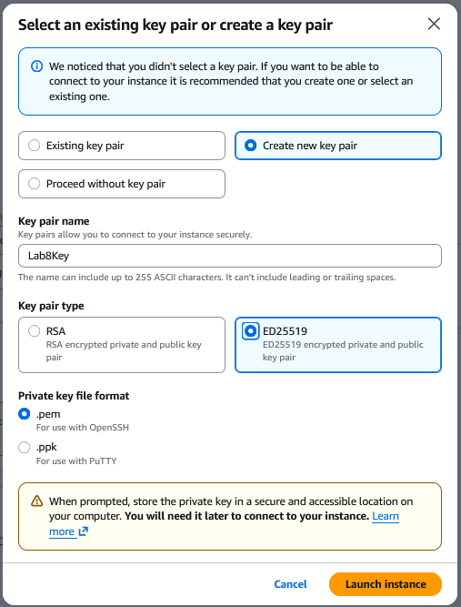

   Capture the final review page and the key download prompt:  
   - Save screenshot as: `task4_launch_instance_config.png` — final review page showing instance name, AMI, type, security group, key pair.
   - Save screenshot as: `task4_keypair_download.png` — Windows File Explorer showing Lab8Key.pem downloaded (do NOT open .pem contents).

3. After launch, EC2 Instances list showing Lab8Machine in "running" state and public IPv4 visible.

   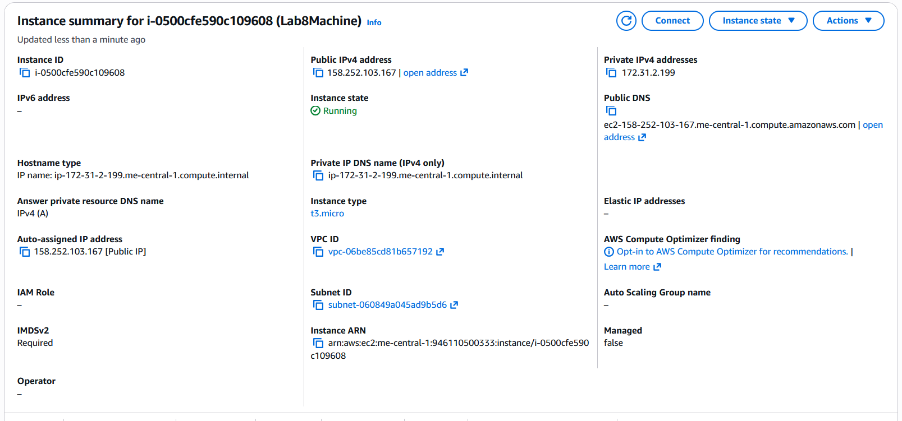

   - Save screenshot as: `task4_instance_running_console.png` — Instances table with Lab8Machine running and Public IPv4.

4. On Windows host, run SSH using the downloaded .pem (PowerShell/Git Bash/Windows Terminal):  
   ```bash
   ssh -i <path>/Lab8Key.pem ec2-user@<public-IP>
   ```  
   Capture the SSH command and successful shell prompt on the EC2 instance:  
   - Save screenshot as: `task4_ssh_from_windows_to_ec2.png` — PowerShell showing ssh command and EC2 shell (do NOT show private key contents).

5. Run the install commands on the EC2 shell:

   ```bash
   sudo dnf update -y
   sudo dnf install -y docker vim-enhanced
   sudo mkdir -p /usr/local/lib/docker/cli-plugins
   sudo curl -fSL --retry 3 https://github.com/docker/compose/releases/latest/download/docker-compose-linux-x86_64 -o /usr/local/lib/docker/cli-plugins/docker-compose
   sudo chmod +x /usr/local/lib/docker/cli-plugins/docker-compose
   sudo systemctl enable --now docker
   ```
   Capture the terminal showing these commands run and successful outputs:  
   - Save screenshot as: `task4_ec2_install_docker_compose_started.png` — outputs of update/install and systemctl start.

6. Create a working directory on EC2 and open the Compose file:

   ```bash
   mkdir -p ~/lab8
   cd ~/lab8
   vim compose.yaml
   ```

   Copy the Compose file from [Gitea](https://github.com/WaqasSaleem97/Gitea/blob/main/compose.yaml). For Gitea, use the current database environment-variable names below in the `gitea` service, matching the PostgreSQL service values. If the downloaded file uses legacy names such as `DB_TYPE` and `DB_HOST`, replace that environment block in your lab copy:

   ```yaml
   environment:
     - GITEA__database__DB_TYPE=postgres
     - GITEA__database__HOST=db:5432
     - GITEA__database__NAME=gitea
     - GITEA__database__USER=gitea
     - GITEA__database__PASSWD=gitea
   ```

   The supplied `gitea` values are training-only database credentials. Keep port `3000:3000` published, and keep the PostgreSQL service internal to the Compose network. Capture the editor with this configuration:  
      - Save screenshot as: `task4_vim_compose_yaml_paste.png` — vim editor showing compose.yaml contents while pasted.

7. Save and verify file exists:  
      - Save screenshot as: `task4_compose_yaml_saved_ls.png` — ls -l showing compose.yaml present.

8. Add ec2-user to docker group, show groups before re-login, exit and reconnect, show groups after reconnect:

   ```bash
   groups    # check current group membership
   sudo usermod -aG docker $USER
   groups    # before re-login
   exit
   # Reconnect
   ssh -i <path>/Lab8Key.pem ec2-user@<public-IP>
   groups    # after re-login (should include docker)
   ```
   - Save screenshot as: `task4_usermod_and_groups_before_after.png` — show usermod command, groups output before exit, reconnect sequence, and groups output after (docker included).

9. Run docker compose up -d from the directory with compose.yaml:

   ```bash
   cd ~/lab8
   docker compose config --quiet
   docker compose up -d
   docker compose ps
   ```
   - Save screenshot as: `task4_docker_compose_up.png` — output of docker compose up -d showing containers starting.

10. Edit the security group Lab8SecurityGroup inbound rules in the EC2 console: add a Custom TCP rule for port 3000 with source **My IP** and save. Capture the inbound rules after saving:  
      - Save screenshot as: `task4_security_group_allow_3000.png` — security group inbound rules showing SSH and Custom TCP port 3000 restricted to your host public IP.

11. From your Windows browser navigate to: http://Public-IP:3000 — capture the Gitea setup/install page:  
      - Save screenshot as: `task4_gitea_install_page.png` — Gitea installation page in browser.

12. Complete the Gitea installation using PostgreSQL host `db:5432`, database `gitea`, and the training database username/password from your Compose file. Set the application URL to `http://<public-IP>:3000/`, choose your own Gitea administrator password, and create a repository. Capture the created repository:  
      - Save screenshot as: `task4_gitea_create_repo.png` — Gitea UI showing the created repository.

13. Task 4 summary (combine evidence)  
      - Save screenshot as: `task4_summary.png` — single screenshot (or tiled screenshot) showing: EC2 Instances list with Lab8Machine running and public IP, security group inbound rules showing SSH and port 3000, and browser tab open to Gitea UI or repo list.

Notes:

- If http://Public-IP:3000 does not load, check instance status, docker compose logs, and security group inbound rules.
- If you used different ports or file paths, document them in your Lab8 writeup.

**Screenshot Required:**

- `task4_open_ec2_console.png`
- `task4_launch_instance_config.png`
- `task4_keypair_download.png`
- `task4_instance_running_console.png`
- `task4_ssh_from_windows_to_ec2.png`
- `task4_ec2_install_docker_compose_started.png`
- `task4_vim_compose_yaml_paste.png`
- `task4_compose_yaml_saved_ls.png`
- `task4_usermod_and_groups_before_after.png`
- `task4_docker_compose_up.png`
- `task4_security_group_allow_3000.png`
- `task4_gitea_install_page.png`
- `task4_gitea_create_repo.png`
- `task4_summary.png`

---

## Cleanup: Remove Lab Resources

Before terminating EC2, copy the final `~/lab8/compose.yaml` into `Labs/Lab08/workspace/` in your local `CC` clone. From the Windows host, after creating that destination directory, an example is:

```powershell
scp -i "$env:USERPROFILE\Downloads\Lab8Key.pem" ec2-user@<public-IP>:~/lab8/compose.yaml .\Labs\Lab08\workspace\compose.yaml
```

Use the actual private-key path on your host. Keep the private key and IAM credential CSV files outside your repository. After verification, remove the resources created for this lab and capture the cleanup results.

Cleanup steps and required screenshots:

1. Terminate the EC2 instance Lab8Machine.  
   - Save screenshot as: `cleanup_terminate_instance.png` — EC2 terminate instance confirmation.

2. Delete associated EBS volumes and snapshots (if any).  
   - Save screenshot as: `cleanup_delete_volumes_snapshots.png` — confirmation or list showing volumes/snapshots deleted.

3. Delete security group Lab8SecurityGroup and key pair Lab8Key from the EC2 console (after instances terminated).  
   - Save screenshot as: `cleanup_delete_security_group_and_keypair.png` — deletion confirmation(s) (show key pair list and security group list after deletion).

4. Delete the temporary `Lab8User` account and its access keys. Then use the account owner/root session to remove the temporary `Admin` user as well, after confirming that the account owner still has access. Delete only the users created for this lab.  
   - Save screenshot as: `cleanup_iam_users_deleted.png` — IAM Users list or deletion confirmations showing that both temporary lab users have been removed.

5. Show the final resource inventory and review Billing for costs incurred during the lab. Cleanup stops continued use of deleted resources; it does not cancel charges already incurred.  
   - Save screenshot as: `cleanup_summary.png` — AWS resource inventories showing the lab resources removed, with the Billing review if available. A zero or unchanged billing display alone is not evidence that resources were deleted.

**Screenshot Required:**

- `cleanup_terminate_instance.png`
- `cleanup_delete_volumes_snapshots.png`
- `cleanup_delete_security_group_and_keypair.png`
- `cleanup_iam_users_deleted.png`
- `cleanup_summary.png`

Important: Keep any local .pem file secure; if you prefer, securely delete local copies after the lab.

---

## Troubleshooting and Notes

- AWS console layouts can differ from the copied reference images. Follow the written resource settings and save screenshots of your own account.
- IAM is global; check `me-central-1` for VPC and EC2 resources. If the region is not active, enable it in Account settings and wait for activation.
- If no default VPC is available, create a default VPC through the VPC console before launching the instance. Use a public subnet, an internet-gateway route, and an assigned public IPv4 address for direct SSH and web access.
- Use Amazon Linux 2023 x86_64 with `t3.micro` so the x86_64 Compose download matches the instance. Follow the [AL2023 package-management documentation](https://docs.aws.amazon.com/linux/al2023/ug/package-management.html).
- Keep `Lab8Key.pem` private and use its actual path with SSH/SCP. If Windows reports an overly permissive private-key file, correct its file ACL for your own Windows account before retrying.
- If Gitea does not load, inspect `docker compose ps` and `docker compose logs --tail=50`, verify the instance public address, and check the port-3000 security-group rule for your current public IP.
- Gitea database configuration uses `GITEA__database__...` names. Its PostgreSQL host is the Compose service name `db:5432`, with the user/database/password matching the `db` service.
- Keep the AWS root and IAM passwords, private key, and credential CSV files out of Git. Only the training Compose file belongs in `workspace/`.
- Remove only the resources created for this lab. Review EC2, EBS, snapshots, security groups, key pairs, and temporary IAM users when finishing.

Source material: [CC_F25 Lab 08](https://github.com/WaqasSaleem97/CC_F25/blob/5490eee82f398eeb11a19fb04a89b34d0b2bdac9/Lab_Tasks/Lab_08/README.md). Consult [AWS EC2 getting started](https://docs.aws.amazon.com/AWSEC2/latest/UserGuide/EC2_GetStarted.html), [AWS region management](https://docs.aws.amazon.com/accounts/latest/reference/manage-acct-regions.html), [Amazon Linux 2 lifecycle](https://aws.amazon.com/amazon-linux-2/faqs/), and [Gitea Docker installation](https://docs.gitea.com/installation/install-with-docker/) for the updated platform details.

## Summary

In this lab, you:

- created an AWS account and enabled the UAE region;
- created and signed in as temporary IAM users;
- inventoried VPC resources;
- launched EC2 and connected using an SSH key;
- deployed Gitea with Docker Compose; and
- removed the lab resources and reviewed billing.

---

## Submission

1. Prepare a solution document containing:
   - a title page with your complete name, registration number, course code, section, and GitHub username;
   - headings for Tasks 1 through 4;
   - the cleanup evidence;
   - screenshots in the same order used in this README; and
   - a short caption below every screenshot.

2. Export the document using this exact filename:

   ```text
   Lab8_Solution.pdf
   ```

3. Place the PDF at `Labs/Lab08/Lab8_Solution.pdf`.

4. Confirm that `workspace/compose.yaml` contains the final lab configuration copied from EC2 **before cleanup**. Include the instructor-provided `images/` directory alongside this README so its reference-image links continue to work. Do not include the private key or IAM credential CSV files.

5. Keep every original screenshot inside `Labs/Lab08/screenshots/`.

6. From the root of the `CC` repository, commit and push the completed lab. The explicit PDF add includes the required solution even if your repository ignores PDF files:

   ```bash
   git status
   git add Labs/Lab08
   git add -f Labs/Lab08/Lab8_Solution.pdf
   git commit -m "Submit Lab 08 evidence"
   git push origin main
   ```

7. Open your `CC` repository on GitHub and confirm that the complete `Labs/Lab08` directory is visible.

---

## Final Submission Checklist

- [ ] `README.md` remains inside `Labs/Lab08/`.
- [ ] `Lab8_Solution.pdf` is inside `Labs/Lab08/` and opens correctly.
- [ ] Every required screenshot is inside `Labs/Lab08/screenshots/` with the exact filename.
- [ ] Terminal and GUI evidence follows the identity and screenshot rules, including the stated account/platform exceptions.
- [ ] `workspace/compose.yaml` contains the final file required by this lab.
- [ ] Tasks 1 through 4 and all required results are included in the PDF.
- [ ] The EC2, storage, security-group, key-pair, and temporary IAM-user cleanup is documented.
- [ ] No real password, password hash, private key, token, recovery code, payment detail, or credential export is included.
- [ ] My submission is stored in the GitHub repository named exactly `CC`.
- [ ] I committed and pushed the complete `Labs/Lab08` directory.
