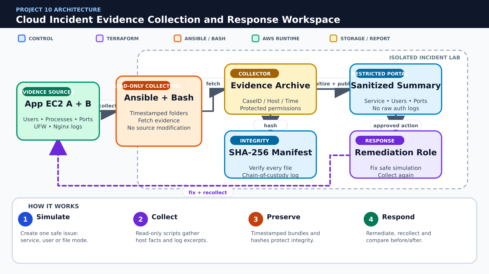

# 🕵️ Project 10 – Cloud Incident Evidence Collection and Response Workspace

**Due Date:** To be announced  
**Total Marks:** 100  
**Submission Format:** GitHub Repository + PDF Report  
**Course Coverage:** Labs 04, 06–07 and 09–15

---

## 📋 Project Overview

Create a defensive incident-response workspace for collecting Linux and Nginx evidence from two EC2 application servers. Terraform provisions an isolated lab, Ansible deploys read-only collection scripts, Bash creates timestamped and hashed evidence bundles, and a restricted Nginx portal presents sanitized incident summaries.

### Scope

- Two application EC2 instances and one evidence collector/portal instance
- Collect system identity, users, processes, listening ports, disk/memory, login records, UFW status and selected Nginx logs
- Use only defensive collection and safe configuration-drift simulations
- No exploitation, credential collection, packet interception, malware tooling or external SIEM

### Mandatory Rules

- Use only the AWS services and course tools explicitly listed in this specification.
- Create infrastructure through Terraform; do not substitute manual AWS Console creation for graded resources.
- Use Ansible and/or Bash for configuration tasks as specified; repeated runs must be safe.
- Never commit AWS credentials, private keys, passwords, Terraform state, real tfvars, or generated secret files.
- Capture evidence before destroying resources and remove chargeable resources immediately after verification.

---

## 🎯 Learning Objectives

- Apply Linux filesystem, permissions, users, processes, logs and shell scripting skills
- Provision an isolated evidence lab with Terraform
- Use Ansible fetch and roles for repeatable remote collection
- Protect evidence integrity with timestamps, permissions and SHA-256 manifests
- Document a safe incident triage and remediation workflow

---

## 🧱 Architecture Overview



**Color guide:** Blue represents users or control, purple represents Terraform, orange represents Ansible or Bash automation, green represents running AWS services, and gold represents storage or reports.

### Simple Project Flow

1. **Simulate:** Create one safe issue: service, user or file mode.
2. **Collect:** Read-only scripts gather host facts and log excerpts.
3. **Preserve:** Timestamped bundles and hashes protect integrity.
4. **Respond:** Remediate, recollect and compare before/after.

> The picture is a conceptual guide. Your report must include your own architecture diagram using the actual resource names, network design and security rules from your implementation.

Create your own architecture diagram in the report. The diagram must show network boundaries, traffic direction, security controls and the Terraform/Ansible/Bash responsibility split.

---

## 📝 Requirements

### Part 1: Git Repository, Planning and Security Hygiene (15 marks)

#### 1.1 Repository Structure (5 marks)

Use this minimum structure and extend it where required:

```text
Project10/
├── README.md
├── .gitignore
├── terraform/modules/network
├── terraform/modules/instances
├── ansible/roles/app
├── ansible/roles/collector
├── ansible/playbooks/collect.yml
├── ansible/playbooks/remediate.yml
├── scripts/collect-local.sh
├── scripts/build-manifest.sh
├── evidence/.gitkeep
├── reports/
├── screenshots/
├── docs/incident-runbook.md
└── report/
```

**Tasks:**

- [ ] Create the documented folder structure.
- [ ] Explain each major directory in README.md.
- [ ] Keep generated files separate from source code.

**Required evidence:**

- `project10_part1_project_structure.png` — readable `tree` output

#### 1.2 Git Workflow (5 marks)

**Tasks:**

- [ ] Create at least two feature branches.
- [ ] Merge changes through pull requests with meaningful descriptions.
- [ ] Preserve readable commits and add a final release tag named `project10-v1.0`.

**Required evidence:**

- `project10_part1_git_history.png` — branch/commit graph and release tag
- `project10_part1_pull_request.png` — merged pull request

#### 1.3 .gitignore and Secret Protection (5 marks)

Your .gitignore must exclude at minimum:

```gitignore
.terraform/
*.tfstate
*.tfstate.*
terraform.tfvars
*.pem
*.key
*.crt
.aws/
.env
__pycache__/
```

Commit example files only, such as `terraform.tfvars.example`. Search staged files and Git history before submission to confirm no credential or private key was committed.

**Required evidence:**

- `project10_part1_gitignore.png` — ignore rules and a clean status/secret check

---

### Part 2: Terraform Infrastructure (30 marks)

#### 2.1 Isolated incident lab network (10 marks)

**Tasks:**

- [ ] Create VPC, subnet, routing and least-privilege security groups.
- [ ] Restrict SSH and the evidence portal to the administrator CIDR.
- [ ] Allow application HTTP only as required for testing.

**Required evidence:**

- `project10_part2_section1_code.png` — relevant Terraform code
- `project10_part2_section1_result.png` — validation, plan, apply, output or AWS verification

#### 2.2 Role-tagged instances (10 marks)

**Tasks:**

- [ ] Create two application instances and one collector instance from a role map.
- [ ] Apply CaseID, Role, Environment and Owner tags.
- [ ] Output instance IDs and IPs for evidence correlation.

**Required evidence:**

- `project10_part2_section2_code.png` — relevant Terraform code
- `project10_part2_section2_result.png` — validation, plan, apply, output or AWS verification

#### 2.3 Validation and chain-of-custody metadata (10 marks)

**Tasks:**

- [ ] Validate CaseID and administrator CIDR inputs.
- [ ] Run Terraform fmt, validate, plan and apply.
- [ ] Record the apply commit hash, Terraform outputs and collection start time in the case notes.

**Required evidence:**

- `project10_part2_section3_code.png` — relevant Terraform code
- `project10_part2_section3_result.png` — validation, plan, apply, output or AWS verification

---

### Part 3: Evidence Collection, Integrity and Portal Automation (25 marks)

#### 3.1 Application and collector roles (8 marks)

**Tasks:**

- [ ] Configure Nginx and generate benign access/error logs on the application hosts.
- [ ] Prepare protected evidence directories on the collector with documented owner/group/modes.
- [ ] Configure the portal to expose only sanitized summaries, never raw auth logs.

**Required evidence:**

- `project10_part3_section1_code.png` — playbook, role, template or script
- `project10_part3_section1_run.png` — successful execution and relevant result

#### 3.2 Collection and manifest workflow (12 marks)

**Tasks:**

- [ ] Collect date, hostname, id, users/groups, ps, ss, df, free, last, UFW status and selected log excerpts.
- [ ] Write each run under CaseID/hostname/timestamp and fetch bundles to the collector.
- [ ] Generate a SHA-256 manifest and a collection log containing source, collector, time and command version.
- [ ] Ensure scripts do not change the collected source data.

**Required evidence:**

- `project10_part3_section2_code.png` — playbook, role, template or script
- `project10_part3_section2_run.png` — successful execution and relevant result

#### 3.3 Triage summary and remediation playbook (5 marks)

**Tasks:**

- [ ] Generate an HTML summary of service state, unexpected users, listening ports and failed logins.
- [ ] Create a narrowly scoped remediation playbook for the simulated issue.
- [ ] Preserve pre-remediation evidence and collect a second post-remediation bundle.

**Required evidence:**

- `project10_part3_section3_code.png` — playbook, role, template or script
- `project10_part3_section3_run.png` — successful execution and relevant result

---

### Part 4: Defensive Incident Drill (20 marks)

#### 4.1 Safe incident simulation and collection (10 marks)

**Tasks:**

- [ ] Simulate one safe issue: stop Nginx, add a temporary non-privileged user, or change a test file permission.
- [ ] Collect evidence and show the summary identifies the exact issue.
- [ ] Verify every evidence file against the SHA-256 manifest.

**Required evidence:**

- `project10_part4_section1_before.png` — initial state or test setup
- `project10_part4_section1_after.png` — verified result, remediation or recovery

#### 4.2 Remediation and preservation (10 marks)

**Tasks:**

- [ ] Run the approved remediation playbook.
- [ ] Collect post-remediation evidence without overwriting the first bundle.
- [ ] Prove service recovery, preserved hashes and restricted portal access.

**Required evidence:**

- `project10_part4_section2_before.png` — initial state or test setup
- `project10_part4_section2_after.png` — verified result, remediation or recovery

---

### Part 5: Documentation, Demonstration and Cleanup (10 marks)

#### 5.1 Documentation and Demonstration (5 marks)

README.md and the PDF report must include:

1. Project overview and architecture diagram
2. Prerequisites and exact deployment sequence
3. Terraform variables, modules, outputs and state strategy
4. Ansible inventory/roles and Bash automation
5. Verification results and screenshots in task order
6. Security decisions and known limitations
7. Troubleshooting and rollback/recovery instructions
8. Cost-control and cleanup instructions

**Required evidence:**

- `project10_part5_readme_report.png` — rendered README and report contents
- `project10_part5_final_demo.png` — final working system

#### 5.2 Cleanup (5 marks)

**Tasks:**

- [ ] Capture all evidence before cleanup.
- [ ] Remove application data that blocks Terraform destroy only through the documented safe method.
- [ ] Run `terraform destroy` for every environment/workspace.
- [ ] Verify that project EC2 instances, volumes, security groups, S3 objects/buckets and other chargeable resources are removed.
- [ ] Keep only source code, sanitized reports and screenshots in GitHub.

**Required evidence:**

- `project10_part5_terraform_destroy.png` — successful destroy
- `project10_part5_aws_cleanup.png` — AWS CLI verification showing no project resources remain

---

## 📦 Submission Guidelines

### GitHub Repository

Use your existing public GitHub repository named `CC`. Store your assigned project in:

```text
CC/Projects/Project-10-incident-evidence-workspace/
```

Submit the direct GitHub URL of this exact project directory. The repository must contain source files, example variables, documentation, screenshots and the final report. It must not contain credentials, private keys, state files or real tfvars.

### PDF Report

Name the report:

```text
Project10_<YourName>_<YourRollNumber>.pdf
```

The report must contain a cover page, table of contents, architecture, implementation, testing, security analysis, challenges, cleanup evidence and conclusion.

---

## 📊 Grading Rubric

| Component | Marks |
|---|---:|
| Part 1: Git Repository, Planning and Security Hygiene | 15 |
| Part 2: Terraform Infrastructure | 30 |
| Part 3: Evidence Collection, Integrity and Portal Automation | 25 |
| Part 4: Defensive Incident Drill | 20 |
| Part 5: Documentation, Demonstration and Cleanup | 10 |
| **Total** | **100** |

Work that cannot be reproduced, exposes credentials, uses prohibited services, or lacks cleanup evidence may lose marks in the relevant sections.

---

## 💡 Tips for Success

- Start with the smallest working Terraform configuration, then add modules.
- Run `terraform fmt -recursive`, `terraform validate` and review `terraform plan` before every apply.
- Use tags consistently because they connect Terraform, AWS CLI and Ansible.
- Test Ansible twice and investigate any unexpected change on the second run.
- Build failure/recovery tests early rather than at the end.
- Destroy test resources as soon as the evidence is complete.

---

## 🐞 Common Issues and Checks

- **Dynamic inventory is empty:** verify AWS credentials, region and tag filters.
- **Ansible cannot connect:** verify key file permissions, username, public IP and security-group source CIDR.
- **Terraform wants unexpected replacement:** inspect the plan and state before applying.
- **Nginx reload fails:** run `nginx -t` and fix the rendered template first.
- **AWS CLI returns no targets:** run the same command without `--query` and confirm tags/region.
- **Destroy fails:** identify dependencies, remove only project-owned data and rerun destroy.

---

## 📚 Official References

- [GitHub Docs: Pull requests](https://docs.github.com/en/pull-requests)
- [Terraform: Modules](https://developer.hashicorp.com/terraform/language/modules)
- [Terraform: State](https://developer.hashicorp.com/terraform/language/state)
- [Terraform AWS Provider](https://registry.terraform.io/providers/hashicorp/aws/latest/docs)
- [Ansible: Roles](https://docs.ansible.com/ansible/latest/playbook_guide/playbooks_reuse_roles.html)
- [Ansible: Amazon EC2 dynamic inventory](https://docs.ansible.com/ansible/latest/collections/amazon/aws/aws_ec2_inventory.html)
- [AWS CLI EC2 Reference](https://docs.aws.amazon.com/cli/latest/reference/ec2/)
- [AWS IAM User Guide](https://docs.aws.amazon.com/IAM/latest/UserGuide/)
- [Amazon S3 User Guide](https://docs.aws.amazon.com/AmazonS3/latest/userguide/)
- [NGINX Documentation](https://nginx.org/en/docs/)

---

## ❓ FAQ

**Can I use a service not listed in the project?**  
No. Request instructor approval before adding a service outside the stated scope.

**Can I configure graded resources manually in the AWS Console?**  
No. The final reproducible implementation must use Terraform and the specified automation. The Console may be used only to inspect results.

**May my team use AI-generated code?**  
Follow the course academic-integrity policy. Every team member must understand, explain and reproduce all submitted work. Cite external assistance where required.

**What if exact AWS values differ from the sample?**  
Resource IDs and IP addresses will differ. Your architecture, tags, security rules, behavior and evidence must satisfy the specification.

---

## 📜 Academic Integrity

Team size and project allocation will be announced by the instructor. Discussion of concepts is allowed, but copying another team's implementation, screenshots, report or Git history is not allowed. Every member must be able to explain the complete solution.

---

## ✅ Final Checklist

- [ ] Repository structure and README are complete.
- [ ] Feature branches, pull requests and release tag are visible.
- [ ] No secrets, keys, state or real tfvars are committed.
- [ ] Terraform format, validation, plan and apply succeed.
- [ ] Required Terraform modules, variables, outputs and tags are present.
- [ ] Ansible inventory, roles/playbooks and scripts work repeatedly.
- [ ] Functional and failure/recovery tests are documented.
- [ ] All exact screenshot filenames are present under screenshots/.
- [ ] PDF report is complete and matches repository evidence.
- [ ] Every project-owned AWS resource has been destroyed and verified.
