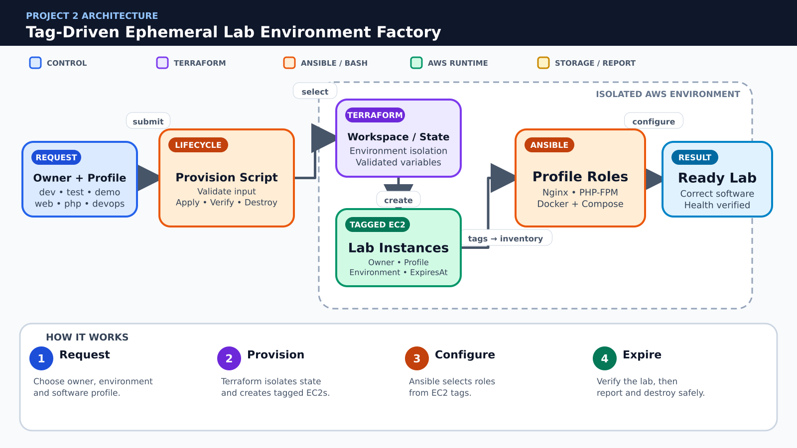

# 🏭 Project 2 – Tag-Driven Ephemeral Lab Environment Factory

**Due Date:** To be announced  
**Total Marks:** 100  
**Submission Format:** GitHub Repository + PDF Report  
**Course Coverage:** Labs 02–03 and 09–14

---

## 📋 Project Overview

Create a self-service factory that provisions short-lived student lab environments by environment name and owner. Terraform modules and workspaces isolate infrastructure, Ansible roles select the requested software profile, and Bash wrappers create, verify and destroy each environment safely.

### Problem to Solve

**Think of this as:** a vending machine that creates temporary cloud laboratories when students need them.

Creating development, testing and demonstration labs manually takes time and often leaves unused AWS resources running. Different users also need different software profiles, while each environment must remain isolated and easy to remove.

### Scope

- Profiles: web (Nginx), php (Nginx + PHP-FPM) and devops (Docker + Compose)
- Environments: dev, test and demo, each isolated through a Terraform workspace or separate state
- Mandatory Owner, ExpiresAt, Profile and Environment tags
- Maximum of three EC2 instances per environment; no ASG, ECS, EKS or Lambda

### Expected Final Result

A controlled lab factory in which a user selects an owner, environment and software profile, then automation creates an isolated and correctly tagged EC2 lab. Ansible installs the selected web, PHP or DevOps profile, verification confirms that it works, and the same workflow can report and safely destroy expired environments.

### Mandatory Rules

- Use only the AWS services and course tools explicitly listed in this specification.
- Create infrastructure through Terraform; do not substitute manual AWS Console creation for graded resources.
- Use Ansible and/or Bash for configuration tasks as specified; repeated runs must be safe.
- Never commit AWS credentials, private keys, passwords, Terraform state, real tfvars, or generated secret files.
- Capture evidence before destroying resources and remove chargeable resources immediately after verification.

---

## 🎯 Learning Objectives

- Build reusable Terraform modules controlled by maps and validated variables
- Isolate environments and state safely
- Use EC2 tags as the contract between Terraform and Ansible dynamic inventory
- Create idempotent profile roles and lifecycle scripts
- Prevent abandoned resources through expiry reporting and mandatory teardown

---

## 🧱 Architecture Overview



**Color guide:** Blue represents users or control, purple represents Terraform, orange represents Ansible or Bash automation, green represents running AWS services, and gold represents storage or reports.

### Simple Project Flow

1. **Request:** Choose owner, environment and software profile.
2. **Provision:** Terraform isolates state and creates tagged EC2s.
3. **Configure:** Ansible selects roles from EC2 tags.
4. **Expire:** Verify the lab, then report and destroy safely.

> The picture is a conceptual guide. Your report must include your own architecture diagram using the actual resource names, network design and security rules from your implementation.

Create your own architecture diagram in the report. The diagram must show network boundaries, traffic direction, security controls and the Terraform/Ansible/Bash responsibility split.

---

## 📝 Requirements

### Part 1: Git Repository, Planning and Security Hygiene (15 marks)

#### 1.1 Repository Structure (5 marks)

Use this minimum structure and extend it where required:

```text
Project2/
├── README.md
├── .gitignore
├── terraform/modules/network
├── terraform/modules/lab_instance
├── terraform/environments/
├── ansible/inventory/aws_ec2.yml
├── ansible/roles/common
├── ansible/roles/web
├── ansible/roles/php
├── ansible/roles/devops
├── scripts/provision-lab.sh
├── scripts/verify-lab.sh
├── scripts/destroy-lab.sh
├── screenshots/
├── docs/
└── report/
```

**Tasks:**

- [ ] Create the documented folder structure.
- [ ] Explain each major directory in README.md.
- [ ] Keep generated files separate from source code.

**Required evidence:**

- `project2_part1_project_structure.png` — readable `tree` output

#### 1.2 Git Workflow (5 marks)

**Tasks:**

- [ ] Create at least two feature branches.
- [ ] Merge changes through pull requests with meaningful descriptions.
- [ ] Preserve readable commits and add a final release tag named `project2-v1.0`.

**Required evidence:**

- `project2_part1_git_history.png` — branch/commit graph and release tag
- `project2_part1_pull_request.png` — merged pull request

#### 1.3 .gitignore and Secret Protection (5 marks)

Your .gitignore must exclude at minimum:

```gitignore
.terraform/
*.tfstate
*.tfstate.*
terraform.tfvars
*.pem
*.key
*.crt
.aws/
.env
__pycache__/
```

Commit example files only, such as `terraform.tfvars.example`. Search staged files and Git history before submission to confirm no credential or private key was committed.

**Required evidence:**

- `project2_part1_gitignore.png` — ignore rules and a clean status/secret check

---

### Part 2: Terraform Infrastructure (30 marks)

#### 2.1 Reusable network module (10 marks)

**Tasks:**

- [ ] Create VPC, subnet, routing and a security group whose allowed ports depend on the selected profile.
- [ ] Restrict SSH to the supplied administrator CIDR.
- [ ] Output network identifiers for the lab-instance module.

**Required evidence:**

- `project2_part2_section1_code.png` — relevant Terraform code
- `project2_part2_section1_result.png` — validation, plan, apply, output or AWS verification

#### 2.2 Profile-aware lab-instance module (10 marks)

**Tasks:**

- [ ] Create 1–3 instances with for_each or count and apply all mandatory tags.
- [ ] Validate profile, environment and instance_count.
- [ ] Generate useful outputs including instance IDs, public IPs and selected profile.

**Required evidence:**

- `project2_part2_section2_code.png` — relevant Terraform code
- `project2_part2_section2_result.png` — validation, plan, apply, output or AWS verification

#### 2.3 Workspace and state isolation (10 marks)

**Tasks:**

- [ ] Create and demonstrate dev, test and demo workspaces or equivalent separate state directories.
- [ ] Prove that resources in one environment are absent from another environment state.
- [ ] Document safe workspace selection before apply or destroy.

**Required evidence:**

- `project2_part2_section3_code.png` — relevant Terraform code
- `project2_part2_section3_result.png` — validation, plan, apply, output or AWS verification

---

### Part 3: Profile Configuration and Lifecycle Automation (25 marks)

#### 3.1 Dynamic inventory contract (8 marks)

**Tasks:**

- [ ] Group hosts by Profile and Environment tags with amazon.aws.aws_ec2.
- [ ] Reject an inventory run when required tags are absent.
- [ ] Use ansible-inventory --graph as evidence.

**Required evidence:**

- `project2_part3_section1_code.png` — playbook, role, template or script
- `project2_part3_section1_run.png` — successful execution and relevant result

#### 3.2 Reusable software-profile roles (12 marks)

**Tasks:**

- [ ] Create common, web, php and devops roles with handlers.
- [ ] Install only the software required by the selected profile.
- [ ] Deploy a landing page that displays owner, profile and environment without exposing secrets.
- [ ] Prove role idempotence with a second run.

**Required evidence:**

- `project2_part3_section2_code.png` — playbook, role, template or script
- `project2_part3_section2_run.png` — successful execution and relevant result

#### 3.3 Lifecycle wrappers (5 marks)

**Tasks:**

- [ ] provision-lab.sh must select/create the state, apply Terraform and run Ansible.
- [ ] verify-lab.sh must check tags, services and HTTP responses.
- [ ] destroy-lab.sh must require explicit environment confirmation before terraform destroy.

**Required evidence:**

- `project2_part3_section3_code.png` — playbook, role, template or script
- `project2_part3_section3_run.png` — successful execution and relevant result

---

### Part 4: Isolation and Expiry Drill (20 marks)

#### 4.1 Two-profile functional test (10 marks)

**Tasks:**

- [ ] Provision two different profiles in separate environments.
- [ ] Verify each environment receives only its selected software and correct landing page.
- [ ] Show separate Terraform state lists and tag-filtered inventories.

**Required evidence:**

- `project2_part4_section1_before.png` — initial state or test setup
- `project2_part4_section1_after.png` — verified result, remediation or recovery

#### 4.2 Expiry and safe teardown (10 marks)

**Tasks:**

- [ ] Produce a report of environments whose ExpiresAt value is due or past due.
- [ ] Destroy one expired test environment with the wrapper.
- [ ] Prove the other workspace and environment remain unchanged.

**Required evidence:**

- `project2_part4_section2_before.png` — initial state or test setup
- `project2_part4_section2_after.png` — verified result, remediation or recovery

---

### Part 5: Documentation, Demonstration and Cleanup (10 marks)

#### 5.1 Documentation and Demonstration (5 marks)

README.md and the PDF report must include:

1. Project overview and architecture diagram
2. Prerequisites and exact deployment sequence
3. Terraform variables, modules, outputs and state strategy
4. Ansible inventory/roles and Bash automation
5. Verification results and screenshots in task order
6. Security decisions and known limitations
7. Troubleshooting and rollback/recovery instructions
8. Cost-control and cleanup instructions

**Required evidence:**

- `project2_part5_readme_report.png` — rendered README and report contents
- `project2_part5_final_demo.png` — final working system

#### 5.2 Cleanup (5 marks)

**Tasks:**

- [ ] Capture all evidence before cleanup.
- [ ] Remove application data that blocks Terraform destroy only through the documented safe method.
- [ ] Run `terraform destroy` for every environment/workspace.
- [ ] Verify that project EC2 instances, volumes, security groups, S3 objects/buckets and other chargeable resources are removed.
- [ ] Keep only source code, sanitized reports and screenshots in GitHub.

**Required evidence:**

- `project2_part5_terraform_destroy.png` — successful destroy
- `project2_part5_aws_cleanup.png` — AWS CLI verification showing no project resources remain

---

## 📦 Submission Guidelines

### GitHub Repository

Use your existing public GitHub repository named `CC`. Store your assigned project in:

```text
CC/Projects/Project-2-ephemeral-lab-factory/
```

Submit the direct GitHub URL of this exact project directory. The repository must contain source files, example variables, documentation, screenshots and the final report. It must not contain credentials, private keys, state files or real tfvars.

### PDF Report

Name the report:

```text
Project2_<YourName>_<YourRollNumber>.pdf
```

The report must contain a cover page, table of contents, architecture, implementation, testing, security analysis, challenges, cleanup evidence and conclusion.

---

## 📊 Grading Rubric

| Component | Marks |
|---|---:|
| Part 1: Git Repository, Planning and Security Hygiene | 15 |
| Part 2: Terraform Infrastructure | 30 |
| Part 3: Profile Configuration and Lifecycle Automation | 25 |
| Part 4: Isolation and Expiry Drill | 20 |
| Part 5: Documentation, Demonstration and Cleanup | 10 |
| **Total** | **100** |

Work that cannot be reproduced, exposes credentials, uses prohibited services, or lacks cleanup evidence may lose marks in the relevant sections.

---

## 💡 Tips for Success

- Start with the smallest working Terraform configuration, then add modules.
- Run `terraform fmt -recursive`, `terraform validate` and review `terraform plan` before every apply.
- Use tags consistently because they connect Terraform, AWS CLI and Ansible.
- Test Ansible twice and investigate any unexpected change on the second run.
- Build failure/recovery tests early rather than at the end.
- Destroy test resources as soon as the evidence is complete.

---

## 🐞 Common Issues and Checks

- **Dynamic inventory is empty:** verify AWS credentials, region and tag filters.
- **Ansible cannot connect:** verify key file permissions, username, public IP and security-group source CIDR.
- **Terraform wants unexpected replacement:** inspect the plan and state before applying.
- **Nginx reload fails:** run `nginx -t` and fix the rendered template first.
- **AWS CLI returns no targets:** run the same command without `--query` and confirm tags/region.
- **Destroy fails:** identify dependencies, remove only project-owned data and rerun destroy.

---

## 📚 Official References

- [GitHub Docs: Pull requests](https://docs.github.com/en/pull-requests)
- [Terraform: Modules](https://developer.hashicorp.com/terraform/language/modules)
- [Terraform: State](https://developer.hashicorp.com/terraform/language/state)
- [Terraform AWS Provider](https://registry.terraform.io/providers/hashicorp/aws/latest/docs)
- [Ansible: Roles](https://docs.ansible.com/ansible/latest/playbook_guide/playbooks_reuse_roles.html)
- [Ansible: Amazon EC2 dynamic inventory](https://docs.ansible.com/ansible/latest/collections/amazon/aws/aws_ec2_inventory.html)
- [AWS CLI EC2 Reference](https://docs.aws.amazon.com/cli/latest/reference/ec2/)
- [AWS IAM User Guide](https://docs.aws.amazon.com/IAM/latest/UserGuide/)
- [Amazon S3 User Guide](https://docs.aws.amazon.com/AmazonS3/latest/userguide/)
- [NGINX Documentation](https://nginx.org/en/docs/)

---

## ❓ FAQ

**Can I use a service not listed in the project?**  
No. Request instructor approval before adding a service outside the stated scope.

**Can I configure graded resources manually in the AWS Console?**  
No. The final reproducible implementation must use Terraform and the specified automation. The Console may be used only to inspect results.

**May my team use AI-generated code?**  
Follow the course academic-integrity policy. Every team member must understand, explain and reproduce all submitted work. Cite external assistance where required.

**What if exact AWS values differ from the sample?**  
Resource IDs and IP addresses will differ. Your architecture, tags, security rules, behavior and evidence must satisfy the specification.

---

## 📜 Academic Integrity

Team size and project allocation will be announced by the instructor. Discussion of concepts is allowed, but copying another team's implementation, screenshots, report or Git history is not allowed. Every member must be able to explain the complete solution.

---

## ✅ Final Checklist

- [ ] Repository structure and README are complete.
- [ ] Feature branches, pull requests and release tag are visible.
- [ ] No secrets, keys, state or real tfvars are committed.
- [ ] Terraform format, validation, plan and apply succeed.
- [ ] Required Terraform modules, variables, outputs and tags are present.
- [ ] Ansible inventory, roles/playbooks and scripts work repeatedly.
- [ ] Functional and failure/recovery tests are documented.
- [ ] All exact screenshot filenames are present under screenshots/.
- [ ] PDF report is complete and matches repository evidence.
- [ ] Every project-owned AWS resource has been destroyed and verified.
