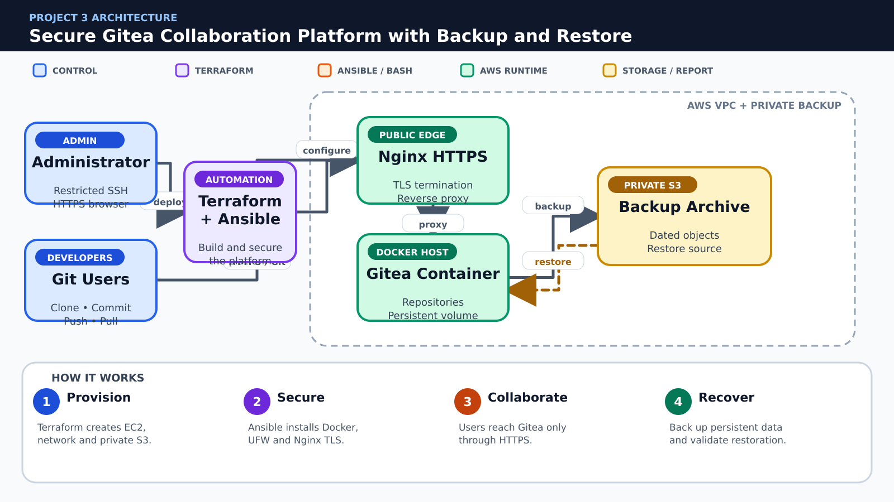

# 🔐 Project 3 – Secure Gitea Collaboration Platform with Backup and Restore

**Due Date:** To be announced  
**Total Marks:** 100  
**Submission Format:** GitHub Repository + PDF Report  
**Course Coverage:** Labs 07–08 and 11–14

---

## 📋 Project Overview

Deploy a private Gitea collaboration service on EC2. Terraform creates the network, compute, security groups and a private S3 backup bucket. Ansible installs Docker, deploys Gitea, places Nginx HTTPS in front of it, configures UFW and automates backup and restore validation.

### Scope

- One EC2 host for Gitea and Nginx; Docker Compose is required
- Private S3 bucket for encrypted-at-rest backup objects with public access blocked
- Self-signed TLS is permitted; HTTP must redirect to HTTPS
- No RDS, managed load balancer, Route 53 or external backup product

### Mandatory Rules

- Use only the AWS services and course tools explicitly listed in this specification.
- Create infrastructure through Terraform; do not substitute manual AWS Console creation for graded resources.
- Use Ansible and/or Bash for configuration tasks as specified; repeated runs must be safe.
- Never commit AWS credentials, private keys, passwords, Terraform state, real tfvars, or generated secret files.
- Capture evidence before destroying resources and remove chargeable resources immediately after verification.

---

## 🎯 Learning Objectives

- Provision a secured Docker workload with Terraform and Ansible
- Use least-privilege network rules and UFW
- Manage Docker Compose content and Nginx configuration through templates
- Back up persistent Gitea data to private S3 without committing secrets
- Perform and document a clean restore drill

---

## 🧱 Architecture Overview



**Color guide:** Blue represents users or control, purple represents Terraform, orange represents Ansible or Bash automation, green represents running AWS services, and gold represents storage or reports.

### Simple Project Flow

1. **Provision:** Terraform creates EC2, network and private S3.
2. **Secure:** Ansible installs Docker, UFW and Nginx TLS.
3. **Collaborate:** Users reach Gitea only through HTTPS.
4. **Recover:** Back up persistent data and validate restoration.

> The picture is a conceptual guide. Your report must include your own architecture diagram using the actual resource names, network design and security rules from your implementation.

Create your own architecture diagram in the report. The diagram must show network boundaries, traffic direction, security controls and the Terraform/Ansible/Bash responsibility split.

---

## 📝 Requirements

### Part 1: Git Repository, Planning and Security Hygiene (15 marks)

#### 1.1 Repository Structure (5 marks)

Use this minimum structure and extend it where required:

```text
Project3/
├── README.md
├── .gitignore
├── terraform/modules/network
├── terraform/modules/compute
├── terraform/modules/backup_bucket
├── ansible/roles/docker
├── ansible/roles/gitea
├── ansible/roles/nginx_tls
├── ansible/roles/backup
├── compose/
├── scripts/backup-gitea.sh
├── scripts/restore-gitea.sh
├── screenshots/
├── docs/
└── report/
```

**Tasks:**

- [ ] Create the documented folder structure.
- [ ] Explain each major directory in README.md.
- [ ] Keep generated files separate from source code.

**Required evidence:**

- `project3_part1_project_structure.png` — readable `tree` output

#### 1.2 Git Workflow (5 marks)

**Tasks:**

- [ ] Create at least two feature branches.
- [ ] Merge changes through pull requests with meaningful descriptions.
- [ ] Preserve readable commits and add a final release tag named `project3-v1.0`.

**Required evidence:**

- `project3_part1_git_history.png` — branch/commit graph and release tag
- `project3_part1_pull_request.png` — merged pull request

#### 1.3 .gitignore and Secret Protection (5 marks)

Your .gitignore must exclude at minimum:

```gitignore
.terraform/
*.tfstate
*.tfstate.*
terraform.tfvars
*.pem
*.key
*.crt
.aws/
.env
__pycache__/
```

Commit example files only, such as `terraform.tfvars.example`. Search staged files and Git history before submission to confirm no credential or private key was committed.

**Required evidence:**

- `project3_part1_gitignore.png` — ignore rules and a clean status/secret check

---

### Part 2: Terraform Infrastructure (30 marks)

#### 2.1 Network and access controls (10 marks)

**Tasks:**

- [ ] Create VPC, public subnet, routing and separate SSH/HTTPS rules.
- [ ] Restrict SSH to your administrator CIDR; do not expose the Gitea container port publicly.
- [ ] Output the public URL and instance identifiers.

**Required evidence:**

- `project3_part2_section1_code.png` — relevant Terraform code
- `project3_part2_section1_result.png` — validation, plan, apply, output or AWS verification

#### 2.2 Compute and private backup bucket (10 marks)

**Tasks:**

- [ ] Create one tagged EC2 instance and a private S3 bucket with public access blocked.
- [ ] Use a unique bucket name derived from variables and locals.
- [ ] Do not output or commit AWS secret values.

**Required evidence:**

- `project3_part2_section2_code.png` — relevant Terraform code
- `project3_part2_section2_result.png` — validation, plan, apply, output or AWS verification

#### 2.3 Variables, state and validation (10 marks)

**Tasks:**

- [ ] Validate allowed CIDR, environment and instance type inputs.
- [ ] Keep tfvars and state out of Git.
- [ ] Run fmt, validate, plan, apply and state list with recorded evidence.

**Required evidence:**

- `project3_part2_section3_code.png` — relevant Terraform code
- `project3_part2_section3_result.png` — validation, plan, apply, output or AWS verification

---

### Part 3: Gitea, TLS and Backup Automation (25 marks)

#### 3.1 Docker and Gitea roles (8 marks)

**Tasks:**

- [ ] Install Docker and Docker Compose with Ansible.
- [ ] Deploy a Compose stack using a named volume or bind-mounted persistent directory.
- [ ] Create handlers so configuration changes restart only the required service.

**Required evidence:**

- `project3_part3_section1_code.png` — playbook, role, template or script
- `project3_part3_section1_run.png` — successful execution and relevant result

#### 3.2 Nginx TLS and host hardening (12 marks)

**Tasks:**

- [ ] Generate a self-signed certificate and configure Nginx as HTTPS reverse proxy.
- [ ] Redirect HTTP to HTTPS and keep the container port inaccessible from the Internet.
- [ ] Enable UFW with only SSH from the admin source and HTTP/HTTPS as required.
- [ ] Verify SSH key authentication and prohibit committed passwords/keys.

**Required evidence:**

- `project3_part3_section2_code.png` — playbook, role, template or script
- `project3_part3_section2_run.png` — successful execution and relevant result

#### 3.3 Backup scheduling (5 marks)

**Tasks:**

- [ ] Create a Bash backup script that archives the persistent Gitea data safely and uploads it to S3.
- [ ] Use date-based names, log success/failure and add a cron schedule.
- [ ] Create a restore script that requires an explicit backup object and confirmation.

**Required evidence:**

- `project3_part3_section3_code.png` — playbook, role, template or script
- `project3_part3_section3_run.png` — successful execution and relevant result

---

### Part 4: Collaboration and Recovery Test (20 marks)

#### 4.1 Platform test (10 marks)

**Tasks:**

- [ ] Open Gitea through HTTPS and create a test repository.
- [ ] Push at least two commits and clone the repository through the configured service.
- [ ] Verify direct public access to the container port is blocked.

**Required evidence:**

- `project3_part4_section1_before.png` — initial state or test setup
- `project3_part4_section1_after.png` — verified result, remediation or recovery

#### 4.2 Backup and restore drill (10 marks)

**Tasks:**

- [ ] Run the backup manually and verify the object exists in the private S3 bucket.
- [ ] Remove only the test repository data after confirming the backup.
- [ ] Restore from the selected archive and prove repository history is available again.

**Required evidence:**

- `project3_part4_section2_before.png` — initial state or test setup
- `project3_part4_section2_after.png` — verified result, remediation or recovery

---

### Part 5: Documentation, Demonstration and Cleanup (10 marks)

#### 5.1 Documentation and Demonstration (5 marks)

README.md and the PDF report must include:

1. Project overview and architecture diagram
2. Prerequisites and exact deployment sequence
3. Terraform variables, modules, outputs and state strategy
4. Ansible inventory/roles and Bash automation
5. Verification results and screenshots in task order
6. Security decisions and known limitations
7. Troubleshooting and rollback/recovery instructions
8. Cost-control and cleanup instructions

**Required evidence:**

- `project3_part5_readme_report.png` — rendered README and report contents
- `project3_part5_final_demo.png` — final working system

#### 5.2 Cleanup (5 marks)

**Tasks:**

- [ ] Capture all evidence before cleanup.
- [ ] Remove application data that blocks Terraform destroy only through the documented safe method.
- [ ] Run `terraform destroy` for every environment/workspace.
- [ ] Verify that project EC2 instances, volumes, security groups, S3 objects/buckets and other chargeable resources are removed.
- [ ] Keep only source code, sanitized reports and screenshots in GitHub.

**Required evidence:**

- `project3_part5_terraform_destroy.png` — successful destroy
- `project3_part5_aws_cleanup.png` — AWS CLI verification showing no project resources remain

---

## 📦 Submission Guidelines

### GitHub Repository

Use your existing public GitHub repository named `CC`. Store your assigned project in:

```text
CC/Projects/Project-3-secure-gitea-platform/
```

Submit the direct GitHub URL of this exact project directory. The repository must contain source files, example variables, documentation, screenshots and the final report. It must not contain credentials, private keys, state files or real tfvars.

### PDF Report

Name the report:

```text
Project3_<YourName>_<YourRollNumber>.pdf
```

The report must contain a cover page, table of contents, architecture, implementation, testing, security analysis, challenges, cleanup evidence and conclusion.

---

## 📊 Grading Rubric

| Component | Marks |
|---|---:|
| Part 1: Git Repository, Planning and Security Hygiene | 15 |
| Part 2: Terraform Infrastructure | 30 |
| Part 3: Gitea, TLS and Backup Automation | 25 |
| Part 4: Collaboration and Recovery Test | 20 |
| Part 5: Documentation, Demonstration and Cleanup | 10 |
| **Total** | **100** |

Work that cannot be reproduced, exposes credentials, uses prohibited services, or lacks cleanup evidence may lose marks in the relevant sections.

---

## 💡 Tips for Success

- Start with the smallest working Terraform configuration, then add modules.
- Run `terraform fmt -recursive`, `terraform validate` and review `terraform plan` before every apply.
- Use tags consistently because they connect Terraform, AWS CLI and Ansible.
- Test Ansible twice and investigate any unexpected change on the second run.
- Build failure/recovery tests early rather than at the end.
- Destroy test resources as soon as the evidence is complete.

---

## 🐞 Common Issues and Checks

- **Dynamic inventory is empty:** verify AWS credentials, region and tag filters.
- **Ansible cannot connect:** verify key file permissions, username, public IP and security-group source CIDR.
- **Terraform wants unexpected replacement:** inspect the plan and state before applying.
- **Nginx reload fails:** run `nginx -t` and fix the rendered template first.
- **AWS CLI returns no targets:** run the same command without `--query` and confirm tags/region.
- **Destroy fails:** identify dependencies, remove only project-owned data and rerun destroy.

---

## 📚 Official References

- [GitHub Docs: Pull requests](https://docs.github.com/en/pull-requests)
- [Terraform: Modules](https://developer.hashicorp.com/terraform/language/modules)
- [Terraform: State](https://developer.hashicorp.com/terraform/language/state)
- [Terraform AWS Provider](https://registry.terraform.io/providers/hashicorp/aws/latest/docs)
- [Ansible: Roles](https://docs.ansible.com/ansible/latest/playbook_guide/playbooks_reuse_roles.html)
- [Ansible: Amazon EC2 dynamic inventory](https://docs.ansible.com/ansible/latest/collections/amazon/aws/aws_ec2_inventory.html)
- [AWS CLI EC2 Reference](https://docs.aws.amazon.com/cli/latest/reference/ec2/)
- [AWS IAM User Guide](https://docs.aws.amazon.com/IAM/latest/UserGuide/)
- [Amazon S3 User Guide](https://docs.aws.amazon.com/AmazonS3/latest/userguide/)
- [NGINX Documentation](https://nginx.org/en/docs/)
- [Gitea: Install with Docker](https://docs.gitea.com/installation/install-with-docker)
- [Docker Compose documentation](https://docs.docker.com/compose/)

---

## ❓ FAQ

**Can I use a service not listed in the project?**  
No. Request instructor approval before adding a service outside the stated scope.

**Can I configure graded resources manually in the AWS Console?**  
No. The final reproducible implementation must use Terraform and the specified automation. The Console may be used only to inspect results.

**May my team use AI-generated code?**  
Follow the course academic-integrity policy. Every team member must understand, explain and reproduce all submitted work. Cite external assistance where required.

**What if exact AWS values differ from the sample?**  
Resource IDs and IP addresses will differ. Your architecture, tags, security rules, behavior and evidence must satisfy the specification.

---

## 📜 Academic Integrity

Team size and project allocation will be announced by the instructor. Discussion of concepts is allowed, but copying another team's implementation, screenshots, report or Git history is not allowed. Every member must be able to explain the complete solution.

---

## ✅ Final Checklist

- [ ] Repository structure and README are complete.
- [ ] Feature branches, pull requests and release tag are visible.
- [ ] No secrets, keys, state or real tfvars are committed.
- [ ] Terraform format, validation, plan and apply succeed.
- [ ] Required Terraform modules, variables, outputs and tags are present.
- [ ] Ansible inventory, roles/playbooks and scripts work repeatedly.
- [ ] Functional and failure/recovery tests are documented.
- [ ] All exact screenshot filenames are present under screenshots/.
- [ ] PDF report is complete and matches repository evidence.
- [ ] Every project-owned AWS resource has been destroyed and verified.
