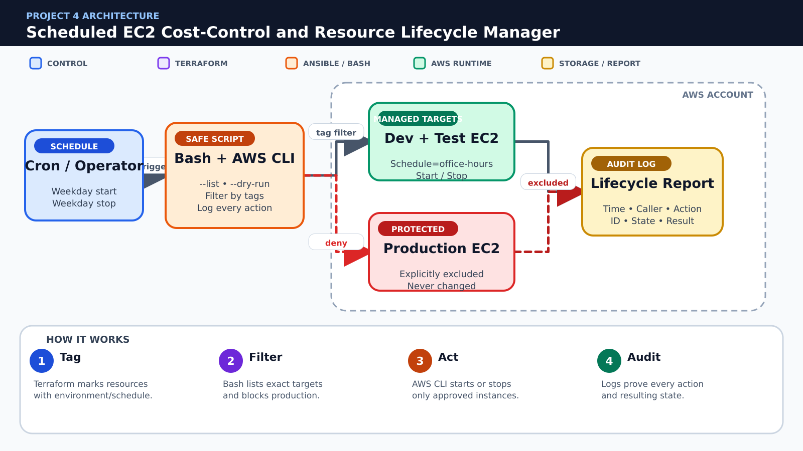

# 💰 Project 4 – Scheduled EC2 Cost-Control and Resource Lifecycle Manager

**Due Date:** To be announced  
**Total Marks:** 100  
**Submission Format:** GitHub Repository + PDF Report  
**Course Coverage:** Labs 06–07 and 09–13

---

## 📋 Project Overview

Create a tag-controlled lifecycle manager that starts, stops and reports on non-production EC2 instances according to an office-hours schedule. Terraform provisions the managed instances and tags, AWS CLI performs lifecycle actions, and Bash plus cron provide safe scheduling, logging and dry-run behavior.

### Scope

- Three non-production EC2 instances with Schedule and Environment tags
- Controller runs from the course Ubuntu server or Codespace with configured AWS CLI
- Start/stop actions must use tag filters and explicit dry-run/list modes
- No Lambda, EventBridge, Systems Manager, billing API or third-party scheduler

### Mandatory Rules

- Use only the AWS services and course tools explicitly listed in this specification.
- Create infrastructure through Terraform; do not substitute manual AWS Console creation for graded resources.
- Use Ansible and/or Bash for configuration tasks as specified; repeated runs must be safe.
- Never commit AWS credentials, private keys, passwords, Terraform state, real tfvars, or generated secret files.
- Capture evidence before destroying resources and remove chargeable resources immediately after verification.

---

## 🎯 Learning Objectives

- Use AWS CLI filters and queries to select resources safely
- Write robust Bash functions, loops, argument checks and log redirection
- Model tag standards and validation in Terraform
- Use Ansible to establish consistent managed-instance services
- Demonstrate scheduled operations without affecting production-tagged resources

---

## 🧱 Architecture Overview



**Color guide:** Blue represents users or control, purple represents Terraform, orange represents Ansible or Bash automation, green represents running AWS services, and gold represents storage or reports.

### Simple Project Flow

1. **Tag:** Terraform marks resources with environment/schedule.
2. **Filter:** Bash lists exact targets and blocks production.
3. **Act:** AWS CLI starts or stops only approved instances.
4. **Audit:** Logs prove every action and resulting state.

> The picture is a conceptual guide. Your report must include your own architecture diagram using the actual resource names, network design and security rules from your implementation.

Create your own architecture diagram in the report. The diagram must show network boundaries, traffic direction, security controls and the Terraform/Ansible/Bash responsibility split.

---

## 📝 Requirements

### Part 1: Git Repository, Planning and Security Hygiene (15 marks)

#### 1.1 Repository Structure (5 marks)

Use this minimum structure and extend it where required:

```text
Project4/
├── README.md
├── .gitignore
├── terraform/modules/network
├── terraform/modules/instances
├── ansible/roles/web_marker
├── scripts/list-targets.sh
├── scripts/start-scheduled.sh
├── scripts/stop-scheduled.sh
├── scripts/lifecycle-report.sh
├── logs/
├── screenshots/
├── docs/
└── report/
```

**Tasks:**

- [ ] Create the documented folder structure.
- [ ] Explain each major directory in README.md.
- [ ] Keep generated files separate from source code.

**Required evidence:**

- `project4_part1_project_structure.png` — readable `tree` output

#### 1.2 Git Workflow (5 marks)

**Tasks:**

- [ ] Create at least two feature branches.
- [ ] Merge changes through pull requests with meaningful descriptions.
- [ ] Preserve readable commits and add a final release tag named `project4-v1.0`.

**Required evidence:**

- `project4_part1_git_history.png` — branch/commit graph and release tag
- `project4_part1_pull_request.png` — merged pull request

#### 1.3 .gitignore and Secret Protection (5 marks)

Your .gitignore must exclude at minimum:

```gitignore
.terraform/
*.tfstate
*.tfstate.*
terraform.tfvars
*.pem
*.key
*.crt
.aws/
.env
__pycache__/
```

Commit example files only, such as `terraform.tfvars.example`. Search staged files and Git history before submission to confirm no credential or private key was committed.

**Required evidence:**

- `project4_part1_gitignore.png` — ignore rules and a clean status/secret check

---

### Part 2: Terraform Infrastructure (30 marks)

#### 2.1 Tagged network and instances (10 marks)

**Tasks:**

- [ ] Create a small VPC/subnet/security group and three schedule-managed instances.
- [ ] Apply Environment, Schedule, Owner and ManagedBy tags from a map/object.
- [ ] Add one protected control instance or documented mock entry tagged Environment=production.

**Required evidence:**

- `project4_part2_section1_code.png` — relevant Terraform code
- `project4_part2_section1_result.png` — validation, plan, apply, output or AWS verification

#### 2.2 Input and safety validation (10 marks)

**Tasks:**

- [ ] Validate allowed schedule names and environments.
- [ ] Prevent an empty or production schedule value from becoming a managed target.
- [ ] Output instance IDs, states and tags without secrets.

**Required evidence:**

- `project4_part2_section2_code.png` — relevant Terraform code
- `project4_part2_section2_result.png` — validation, plan, apply, output or AWS verification

#### 2.3 State and AWS CLI comparison (10 marks)

**Tasks:**

- [ ] Run Terraform validation and apply.
- [ ] Compare terraform output with aws ec2 describe-instances filtered by project tags.
- [ ] Document the relationship among configuration, state and live AWS data.

**Required evidence:**

- `project4_part2_section3_code.png` — relevant Terraform code
- `project4_part2_section3_result.png` — validation, plan, apply, output or AWS verification

---

### Part 3: Lifecycle Scripts and Scheduling (25 marks)

#### 3.1 Ansible web markers (8 marks)

**Tasks:**

- [ ] Configure Nginx on managed instances and display environment/schedule identity.
- [ ] Use dynamic inventory filtered by project tags.
- [ ] Demonstrate idempotence.

**Required evidence:**

- `project4_part3_section1_code.png` — playbook, role, template or script
- `project4_part3_section1_run.png` — successful execution and relevant result

#### 3.2 Safe start/stop scripts (12 marks)

**Tasks:**

- [ ] Implement --list and --dry-run modes before real action.
- [ ] Use tag filters to build the exact target ID list.
- [ ] Refuse to act on Environment=production and refuse an empty target list.
- [ ] Log timestamp, caller, action, instance ID and result; return non-zero on failure.

**Required evidence:**

- `project4_part3_section2_code.png` — playbook, role, template or script
- `project4_part3_section2_run.png` — successful execution and relevant result

#### 3.3 Cron and reporting (5 marks)

**Tasks:**

- [ ] Create documented cron entries for weekday start and stop times.
- [ ] Generate a lifecycle report showing last action and current state.
- [ ] Keep logs free of credentials and include log rotation guidance without configuring un-taught services.

**Required evidence:**

- `project4_part3_section3_code.png` — playbook, role, template or script
- `project4_part3_section3_run.png` — successful execution and relevant result

---

### Part 4: Schedule Safety Test (20 marks)

#### 4.1 Start/stop functional test (10 marks)

**Tasks:**

- [ ] Stop the managed test instances with the script, verify states, then start them again.
- [ ] Confirm Nginx health after instances return to running.
- [ ] Capture list, dry-run and real-action evidence.

**Required evidence:**

- `project4_part4_section1_before.png` — initial state or test setup
- `project4_part4_section1_after.png` — verified result, remediation or recovery

#### 4.2 Production-protection test (10 marks)

**Tasks:**

- [ ] Show that the production-tagged control resource is excluded.
- [ ] Attempt a deliberately broad input and prove the script refuses it.
- [ ] Document how tag mistakes are corrected through Terraform.

**Required evidence:**

- `project4_part4_section2_before.png` — initial state or test setup
- `project4_part4_section2_after.png` — verified result, remediation or recovery

---

### Part 5: Documentation, Demonstration and Cleanup (10 marks)

#### 5.1 Documentation and Demonstration (5 marks)

README.md and the PDF report must include:

1. Project overview and architecture diagram
2. Prerequisites and exact deployment sequence
3. Terraform variables, modules, outputs and state strategy
4. Ansible inventory/roles and Bash automation
5. Verification results and screenshots in task order
6. Security decisions and known limitations
7. Troubleshooting and rollback/recovery instructions
8. Cost-control and cleanup instructions

**Required evidence:**

- `project4_part5_readme_report.png` — rendered README and report contents
- `project4_part5_final_demo.png` — final working system

#### 5.2 Cleanup (5 marks)

**Tasks:**

- [ ] Capture all evidence before cleanup.
- [ ] Remove application data that blocks Terraform destroy only through the documented safe method.
- [ ] Run `terraform destroy` for every environment/workspace.
- [ ] Verify that project EC2 instances, volumes, security groups, S3 objects/buckets and other chargeable resources are removed.
- [ ] Keep only source code, sanitized reports and screenshots in GitHub.

**Required evidence:**

- `project4_part5_terraform_destroy.png` — successful destroy
- `project4_part5_aws_cleanup.png` — AWS CLI verification showing no project resources remain

---

## 📦 Submission Guidelines

### GitHub Repository

Use your existing public GitHub repository named `CC`. Store your assigned project in:

```text
CC/Projects/Project-4-ec2-cost-control-manager/
```

Submit the direct GitHub URL of this exact project directory. The repository must contain source files, example variables, documentation, screenshots and the final report. It must not contain credentials, private keys, state files or real tfvars.

### PDF Report

Name the report:

```text
Project4_<YourName>_<YourRollNumber>.pdf
```

The report must contain a cover page, table of contents, architecture, implementation, testing, security analysis, challenges, cleanup evidence and conclusion.

---

## 📊 Grading Rubric

| Component | Marks |
|---|---:|
| Part 1: Git Repository, Planning and Security Hygiene | 15 |
| Part 2: Terraform Infrastructure | 30 |
| Part 3: Lifecycle Scripts and Scheduling | 25 |
| Part 4: Schedule Safety Test | 20 |
| Part 5: Documentation, Demonstration and Cleanup | 10 |
| **Total** | **100** |

Work that cannot be reproduced, exposes credentials, uses prohibited services, or lacks cleanup evidence may lose marks in the relevant sections.

---

## 💡 Tips for Success

- Start with the smallest working Terraform configuration, then add modules.
- Run `terraform fmt -recursive`, `terraform validate` and review `terraform plan` before every apply.
- Use tags consistently because they connect Terraform, AWS CLI and Ansible.
- Test Ansible twice and investigate any unexpected change on the second run.
- Build failure/recovery tests early rather than at the end.
- Destroy test resources as soon as the evidence is complete.

---

## 🐞 Common Issues and Checks

- **Dynamic inventory is empty:** verify AWS credentials, region and tag filters.
- **Ansible cannot connect:** verify key file permissions, username, public IP and security-group source CIDR.
- **Terraform wants unexpected replacement:** inspect the plan and state before applying.
- **Nginx reload fails:** run `nginx -t` and fix the rendered template first.
- **AWS CLI returns no targets:** run the same command without `--query` and confirm tags/region.
- **Destroy fails:** identify dependencies, remove only project-owned data and rerun destroy.

---

## 📚 Official References

- [GitHub Docs: Pull requests](https://docs.github.com/en/pull-requests)
- [Terraform: Modules](https://developer.hashicorp.com/terraform/language/modules)
- [Terraform: State](https://developer.hashicorp.com/terraform/language/state)
- [Terraform AWS Provider](https://registry.terraform.io/providers/hashicorp/aws/latest/docs)
- [Ansible: Roles](https://docs.ansible.com/ansible/latest/playbook_guide/playbooks_reuse_roles.html)
- [Ansible: Amazon EC2 dynamic inventory](https://docs.ansible.com/ansible/latest/collections/amazon/aws/aws_ec2_inventory.html)
- [AWS CLI EC2 Reference](https://docs.aws.amazon.com/cli/latest/reference/ec2/)
- [AWS IAM User Guide](https://docs.aws.amazon.com/IAM/latest/UserGuide/)
- [Amazon S3 User Guide](https://docs.aws.amazon.com/AmazonS3/latest/userguide/)
- [NGINX Documentation](https://nginx.org/en/docs/)

---

## ❓ FAQ

**Can I use a service not listed in the project?**  
No. Request instructor approval before adding a service outside the stated scope.

**Can I configure graded resources manually in the AWS Console?**  
No. The final reproducible implementation must use Terraform and the specified automation. The Console may be used only to inspect results.

**May my team use AI-generated code?**  
Follow the course academic-integrity policy. Every team member must understand, explain and reproduce all submitted work. Cite external assistance where required.

**What if exact AWS values differ from the sample?**  
Resource IDs and IP addresses will differ. Your architecture, tags, security rules, behavior and evidence must satisfy the specification.

---

## 📜 Academic Integrity

Team size and project allocation will be announced by the instructor. Discussion of concepts is allowed, but copying another team's implementation, screenshots, report or Git history is not allowed. Every member must be able to explain the complete solution.

---

## ✅ Final Checklist

- [ ] Repository structure and README are complete.
- [ ] Feature branches, pull requests and release tag are visible.
- [ ] No secrets, keys, state or real tfvars are committed.
- [ ] Terraform format, validation, plan and apply succeed.
- [ ] Required Terraform modules, variables, outputs and tags are present.
- [ ] Ansible inventory, roles/playbooks and scripts work repeatedly.
- [ ] Functional and failure/recovery tests are documented.
- [ ] All exact screenshot filenames are present under screenshots/.
- [ ] PDF report is complete and matches repository evidence.
- [ ] Every project-owned AWS resource has been destroyed and verified.
