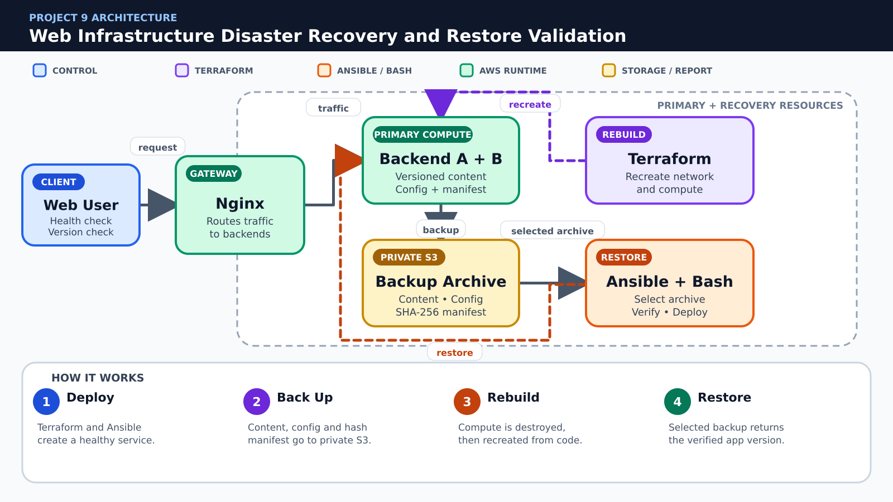

# 🛟 Project 9 – Web Infrastructure Disaster Recovery and Restore Validation

**Due Date:** To be announced  
**Total Marks:** 100  
**Submission Format:** GitHub Repository + PDF Report  
**Course Coverage:** Labs 09–15

---

## 📋 Project Overview

Design a recoverable Nginx web service using Terraform, Ansible, a private S3 backup bucket and scripted restore validation. Students deploy a primary environment, back up application/configuration data, destroy the compute tier, rebuild it and prove recovery against documented RTO and RPO targets.

### Problem to Solve

**Think of this as:** a disaster drill that proves a deleted web environment can be rebuilt and restored.

Keeping a backup does not guarantee recovery after servers are lost. The organization must prove that infrastructure can be recreated, the correct archive can be restored and the recovered service meets documented recovery objectives.

### Scope

- One Nginx gateway and two backend EC2 instances
- Private S3 bucket for versioned backup archives; Terraform state must be handled separately
- Back up application content and course-scope configuration, not full machine images
- No RDS, AWS Backup, AMI automation, cross-region replication or managed load balancer

### Expected Final Result

A complete disaster-recovery demonstration: deploy the web service, back up application content and configuration with a SHA-256 manifest to private versioned S3 storage, destroy the compute tier, rebuild it with Terraform, restore it with Ansible and Bash, and verify the recovered application version, integrity, RTO and RPO evidence.

### Mandatory Rules

- Use only the AWS services and course tools explicitly listed in this specification.
- Create infrastructure through Terraform; do not substitute manual AWS Console creation for graded resources.
- Use Ansible and/or Bash for configuration tasks as specified; repeated runs must be safe.
- Never commit AWS credentials, private keys, passwords, Terraform state, real tfvars, or generated secret files.
- Capture evidence before destroying resources and remove chargeable resources immediately after verification.

---

## 🎯 Learning Objectives

- Separate reproducible infrastructure from backed-up application data
- Create private S3 storage and safe Terraform state handling
- Automate backup, rebuild and restore with Ansible and Bash
- Validate restored service content and configuration
- Measure and document recovery time and recovery point

---

## 🧱 Architecture Overview



**Color guide:** Blue represents users or control, purple represents Terraform, orange represents Ansible or Bash automation, green represents running AWS services, and gold represents storage or reports.

### Simple Project Flow

1. **Deploy:** Terraform and Ansible create a healthy service.
2. **Back Up:** Content, config and hash manifest go to private S3.
3. **Rebuild:** Compute is destroyed, then recreated from code.
4. **Restore:** Selected backup returns the verified app version.

> The picture is a conceptual guide. Your report must include your own architecture diagram using the actual resource names, network design and security rules from your implementation.

Create your own architecture diagram in the report. The diagram must show network boundaries, traffic direction, security controls and the Terraform/Ansible/Bash responsibility split.

---

## 📝 Requirements

### Part 1: Git Repository, Planning and Security Hygiene (15 marks)

#### 1.1 Repository Structure (5 marks)

Use this minimum structure and extend it where required:

```text
Project9/
├── README.md
├── .gitignore
├── terraform/modules/network
├── terraform/modules/gateway
├── terraform/modules/backends
├── terraform/modules/backup_bucket
├── ansible/roles/web
├── ansible/roles/backup
├── ansible/roles/restore
├── scripts/backup.sh
├── scripts/rebuild.sh
├── scripts/restore.sh
├── backups/manifest.example
├── screenshots/
├── docs/runbook.md
└── report/
```

**Tasks:**

- [ ] Create the documented folder structure.
- [ ] Explain each major directory in README.md.
- [ ] Keep generated files separate from source code.

**Required evidence:**

- `project9_part1_project_structure.png` — readable `tree` output

#### 1.2 Git Workflow (5 marks)

**Tasks:**

- [ ] Create at least two feature branches.
- [ ] Merge changes through pull requests with meaningful descriptions.
- [ ] Preserve readable commits and add a final release tag named `project9-v1.0`.

**Required evidence:**

- `project9_part1_git_history.png` — branch/commit graph and release tag
- `project9_part1_pull_request.png` — merged pull request

#### 1.3 .gitignore and Secret Protection (5 marks)

Your .gitignore must exclude at minimum:

```gitignore
.terraform/
*.tfstate
*.tfstate.*
terraform.tfvars
*.pem
*.key
*.crt
.aws/
.env
__pycache__/
```

Commit example files only, such as `terraform.tfvars.example`. Search staged files and Git history before submission to confirm no credential or private key was committed.

**Required evidence:**

- `project9_part1_gitignore.png` — ignore rules and a clean status/secret check

---

### Part 2: Terraform Infrastructure (30 marks)

#### 2.1 Recoverable network and compute (10 marks)

**Tasks:**

- [ ] Provision VPC, routing, security groups, gateway and two backends through modules.
- [ ] Keep all required values in variables, locals and outputs so compute can be recreated.
- [ ] Do not depend on manually configured AWS resources.

**Required evidence:**

- `project9_part2_section1_code.png` — relevant Terraform code
- `project9_part2_section1_result.png` — validation, plan, apply, output or AWS verification

#### 2.2 Private backup bucket (10 marks)

**Tasks:**

- [ ] Create an S3 bucket with public access blocked and versioning enabled.
- [ ] Use a unique name and document retention/cleanup.
- [ ] Keep Terraform state and application backup prefixes clearly separated.

**Required evidence:**

- `project9_part2_section2_code.png` — relevant Terraform code
- `project9_part2_section2_result.png` — validation, plan, apply, output or AWS verification

#### 2.3 State and rebuild readiness (10 marks)

**Tasks:**

- [ ] Use local or S3 remote state as taught and explain its protection.
- [ ] Run fmt, validate, plan and apply.
- [ ] Export only non-secret outputs required by Ansible and restore scripts.

**Required evidence:**

- `project9_part2_section3_code.png` — relevant Terraform code
- `project9_part2_section3_result.png` — validation, plan, apply, output or AWS verification

---

### Part 3: Backup, Rebuild and Restore Automation (25 marks)

#### 3.1 Web deployment role (8 marks)

**Tasks:**

- [ ] Configure gateway/backends and deploy versioned application content.
- [ ] Create a health endpoint and a content manifest containing file names and SHA-256 checksums.
- [ ] Prove a second playbook run is idempotent.

**Required evidence:**

- `project9_part3_section1_code.png` — playbook, role, template or script
- `project9_part3_section1_run.png` — successful execution and relevant result

#### 3.2 Backup and restore roles (12 marks)

**Tasks:**

- [ ] Archive application content, selected Nginx configuration and the manifest.
- [ ] Upload dated archives to S3 and log object name, timestamp and result.
- [ ] Restore only from an explicitly selected object, validate checksums and run nginx -t before reload.
- [ ] Never include private keys, credentials or Terraform state in application backups.

**Required evidence:**

- `project9_part3_section2_code.png` — playbook, role, template or script
- `project9_part3_section2_run.png` — successful execution and relevant result

#### 3.3 Orchestration scripts (5 marks)

**Tasks:**

- [ ] backup.sh, rebuild.sh and restore.sh must use set -euo pipefail and clear confirmations.
- [ ] Record phase start/end times for RTO measurement.
- [ ] Stop immediately when Terraform, Ansible or checksum validation fails.

**Required evidence:**

- `project9_part3_section3_code.png` — playbook, role, template or script
- `project9_part3_section3_run.png` — successful execution and relevant result

---

### Part 4: Full Disaster-Recovery Drill (20 marks)

#### 4.1 Backup validation (10 marks)

**Tasks:**

- [ ] Create a backup of a known application version.
- [ ] List the private S3 object and download/inspect its manifest without exposing secrets.
- [ ] Record backup timestamp as the recovery point.

**Required evidence:**

- `project9_part4_section1_before.png` — initial state or test setup
- `project9_part4_section1_after.png` — verified result, remediation or recovery

#### 4.2 Destroy, rebuild and restore (10 marks)

**Tasks:**

- [ ] Destroy only the compute tier while preserving backup/state resources.
- [ ] Recreate compute from Terraform and restore with Ansible.
- [ ] Prove the application version/checksums match, health checks pass and record achieved RTO/RPO.

**Required evidence:**

- `project9_part4_section2_before.png` — initial state or test setup
- `project9_part4_section2_after.png` — verified result, remediation or recovery

---

### Part 5: Documentation, Demonstration and Cleanup (10 marks)

#### 5.1 Documentation and Demonstration (5 marks)

README.md and the PDF report must include:

1. Project overview and architecture diagram
2. Prerequisites and exact deployment sequence
3. Terraform variables, modules, outputs and state strategy
4. Ansible inventory/roles and Bash automation
5. Verification results and screenshots in task order
6. Security decisions and known limitations
7. Troubleshooting and rollback/recovery instructions
8. Cost-control and cleanup instructions

**Required evidence:**

- `project9_part5_readme_report.png` — rendered README and report contents
- `project9_part5_final_demo.png` — final working system

#### 5.2 Cleanup (5 marks)

**Tasks:**

- [ ] Capture all evidence before cleanup.
- [ ] Remove application data that blocks Terraform destroy only through the documented safe method.
- [ ] Run `terraform destroy` for every environment/workspace.
- [ ] Verify that project EC2 instances, volumes, security groups, S3 objects/buckets and other chargeable resources are removed.
- [ ] Keep only source code, sanitized reports and screenshots in GitHub.

**Required evidence:**

- `project9_part5_terraform_destroy.png` — successful destroy
- `project9_part5_aws_cleanup.png` — AWS CLI verification showing no project resources remain

---

## 📦 Submission Guidelines

### GitHub Repository

Use your existing public GitHub repository named `CC`. Store your assigned project in:

```text
CC/Projects/Project-9-web-disaster-recovery/
```

Submit the direct GitHub URL of this exact project directory. The repository must contain source files, example variables, documentation, screenshots and the final report. It must not contain credentials, private keys, state files or real tfvars.

### PDF Report

Name the report:

```text
Project9_<YourName>_<YourRollNumber>.pdf
```

The report must contain a cover page, table of contents, architecture, implementation, testing, security analysis, challenges, cleanup evidence and conclusion.

---

## 📊 Grading Rubric

| Component | Marks |
|---|---:|
| Part 1: Git Repository, Planning and Security Hygiene | 15 |
| Part 2: Terraform Infrastructure | 30 |
| Part 3: Backup, Rebuild and Restore Automation | 25 |
| Part 4: Full Disaster-Recovery Drill | 20 |
| Part 5: Documentation, Demonstration and Cleanup | 10 |
| **Total** | **100** |

Work that cannot be reproduced, exposes credentials, uses prohibited services, or lacks cleanup evidence may lose marks in the relevant sections.

---

## 💡 Tips for Success

- Start with the smallest working Terraform configuration, then add modules.
- Run `terraform fmt -recursive`, `terraform validate` and review `terraform plan` before every apply.
- Use tags consistently because they connect Terraform, AWS CLI and Ansible.
- Test Ansible twice and investigate any unexpected change on the second run.
- Build failure/recovery tests early rather than at the end.
- Destroy test resources as soon as the evidence is complete.

---

## 🐞 Common Issues and Checks

- **Dynamic inventory is empty:** verify AWS credentials, region and tag filters.
- **Ansible cannot connect:** verify key file permissions, username, public IP and security-group source CIDR.
- **Terraform wants unexpected replacement:** inspect the plan and state before applying.
- **Nginx reload fails:** run `nginx -t` and fix the rendered template first.
- **AWS CLI returns no targets:** run the same command without `--query` and confirm tags/region.
- **Destroy fails:** identify dependencies, remove only project-owned data and rerun destroy.

---

## 📚 Official References

- [GitHub Docs: Pull requests](https://docs.github.com/en/pull-requests)
- [Terraform: Modules](https://developer.hashicorp.com/terraform/language/modules)
- [Terraform: State](https://developer.hashicorp.com/terraform/language/state)
- [Terraform AWS Provider](https://registry.terraform.io/providers/hashicorp/aws/latest/docs)
- [Ansible: Roles](https://docs.ansible.com/ansible/latest/playbook_guide/playbooks_reuse_roles.html)
- [Ansible: Amazon EC2 dynamic inventory](https://docs.ansible.com/ansible/latest/collections/amazon/aws/aws_ec2_inventory.html)
- [AWS CLI EC2 Reference](https://docs.aws.amazon.com/cli/latest/reference/ec2/)
- [AWS IAM User Guide](https://docs.aws.amazon.com/IAM/latest/UserGuide/)
- [Amazon S3 User Guide](https://docs.aws.amazon.com/AmazonS3/latest/userguide/)
- [NGINX Documentation](https://nginx.org/en/docs/)

---

## ❓ FAQ

**Can I use a service not listed in the project?**  
No. Request instructor approval before adding a service outside the stated scope.

**Can I configure graded resources manually in the AWS Console?**  
No. The final reproducible implementation must use Terraform and the specified automation. The Console may be used only to inspect results.

**May my team use AI-generated code?**  
Follow the course academic-integrity policy. Every team member must understand, explain and reproduce all submitted work. Cite external assistance where required.

**What if exact AWS values differ from the sample?**  
Resource IDs and IP addresses will differ. Your architecture, tags, security rules, behavior and evidence must satisfy the specification.

---

## 📜 Academic Integrity

Team size and project allocation will be announced by the instructor. Discussion of concepts is allowed, but copying another team's implementation, screenshots, report or Git history is not allowed. Every member must be able to explain the complete solution.

---

## ✅ Final Checklist

- [ ] Repository structure and README are complete.
- [ ] Feature branches, pull requests and release tag are visible.
- [ ] No secrets, keys, state or real tfvars are committed.
- [ ] Terraform format, validation, plan and apply succeed.
- [ ] Required Terraform modules, variables, outputs and tags are present.
- [ ] Ansible inventory, roles/playbooks and scripts work repeatedly.
- [ ] Functional and failure/recovery tests are documented.
- [ ] All exact screenshot filenames are present under screenshots/.
- [ ] PDF report is complete and matches repository evidence.
- [ ] Every project-owned AWS resource has been destroyed and verified.
